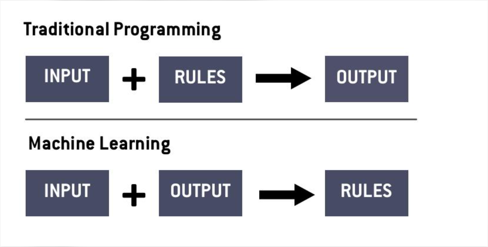
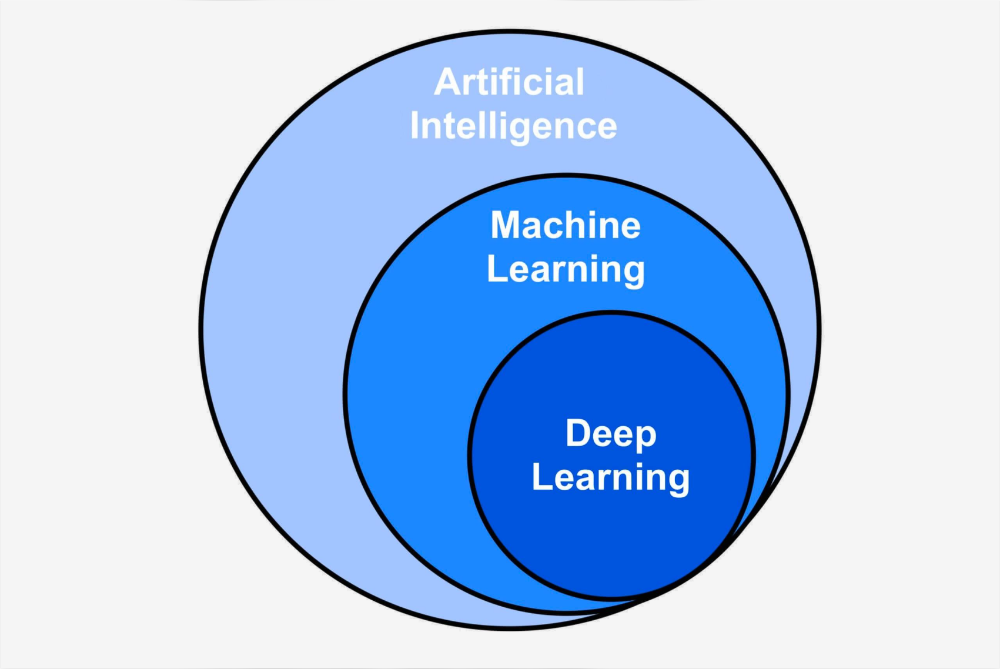
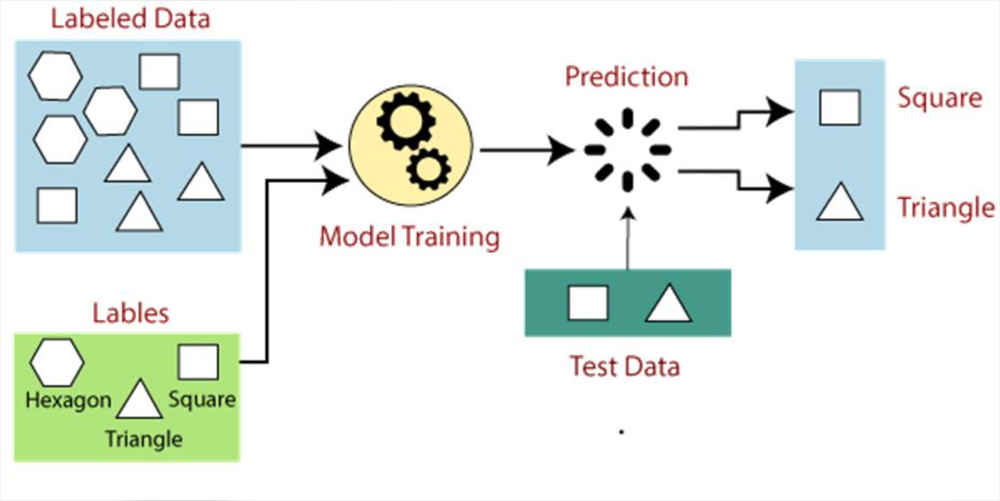
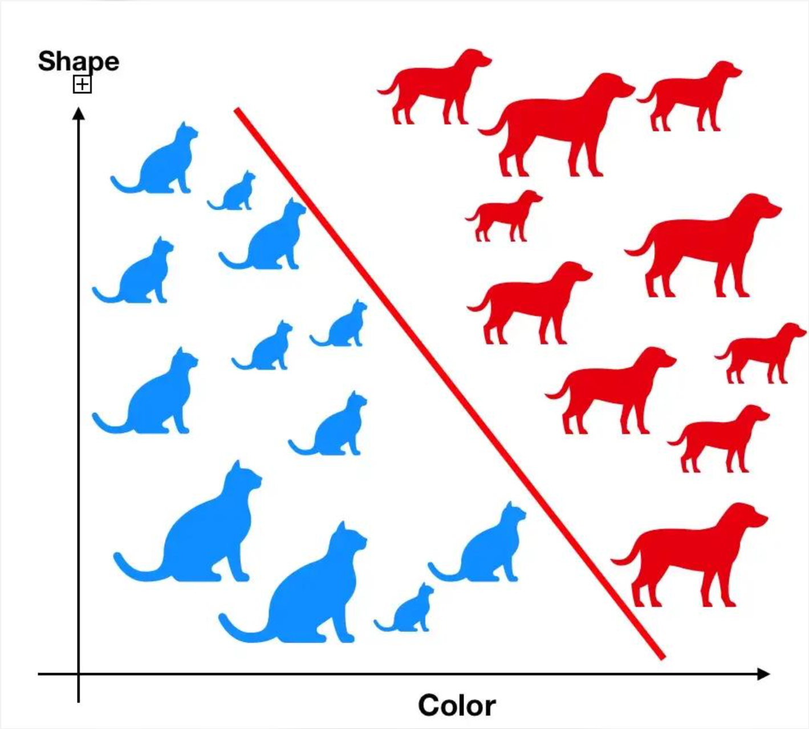
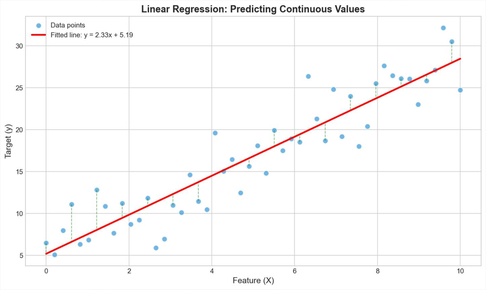
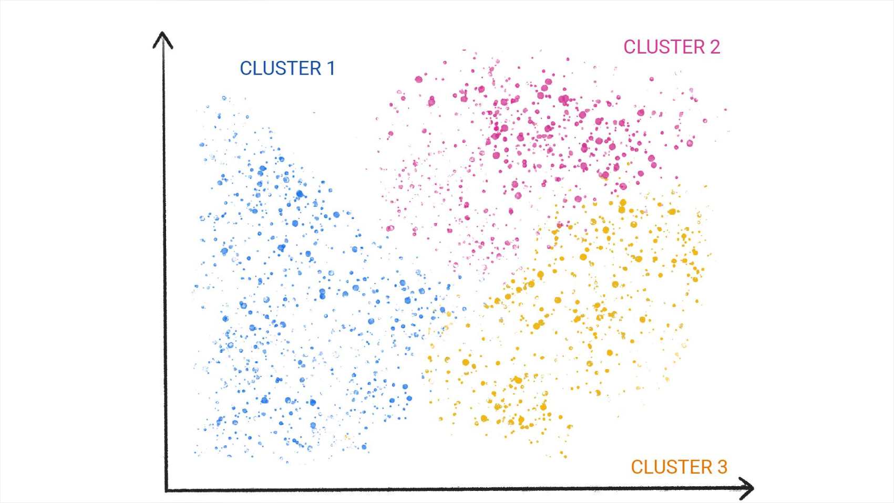
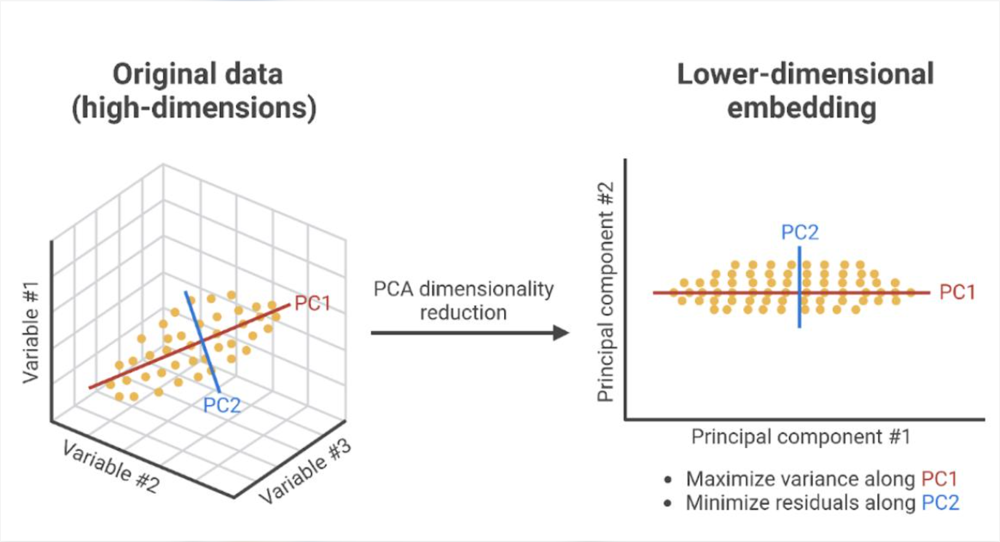
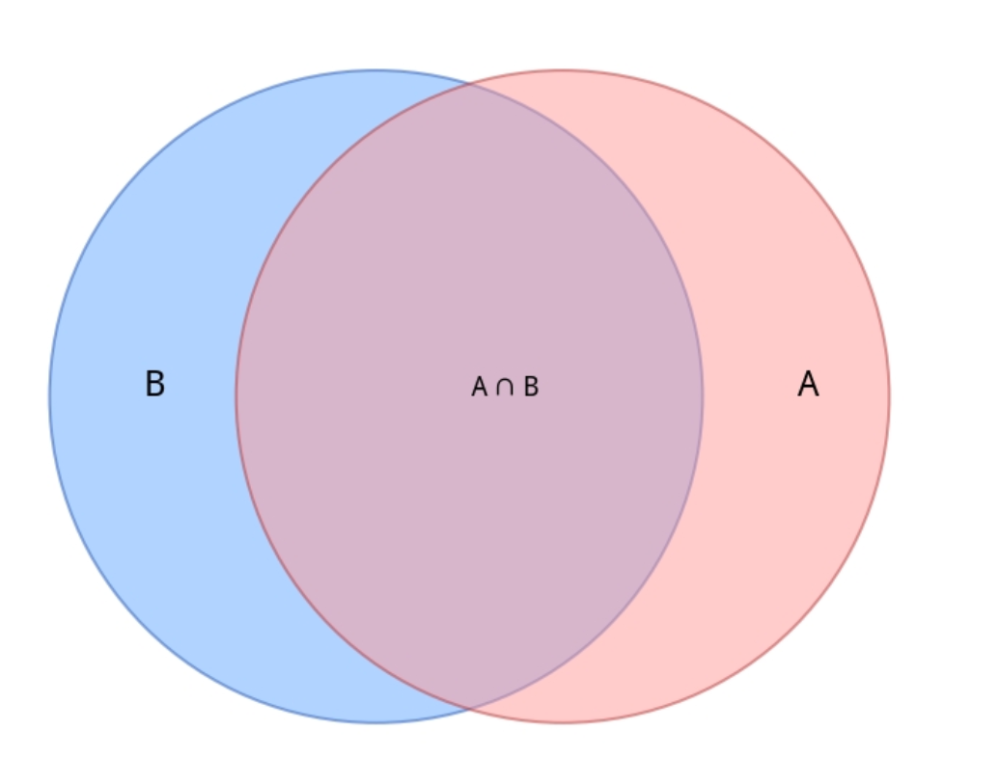
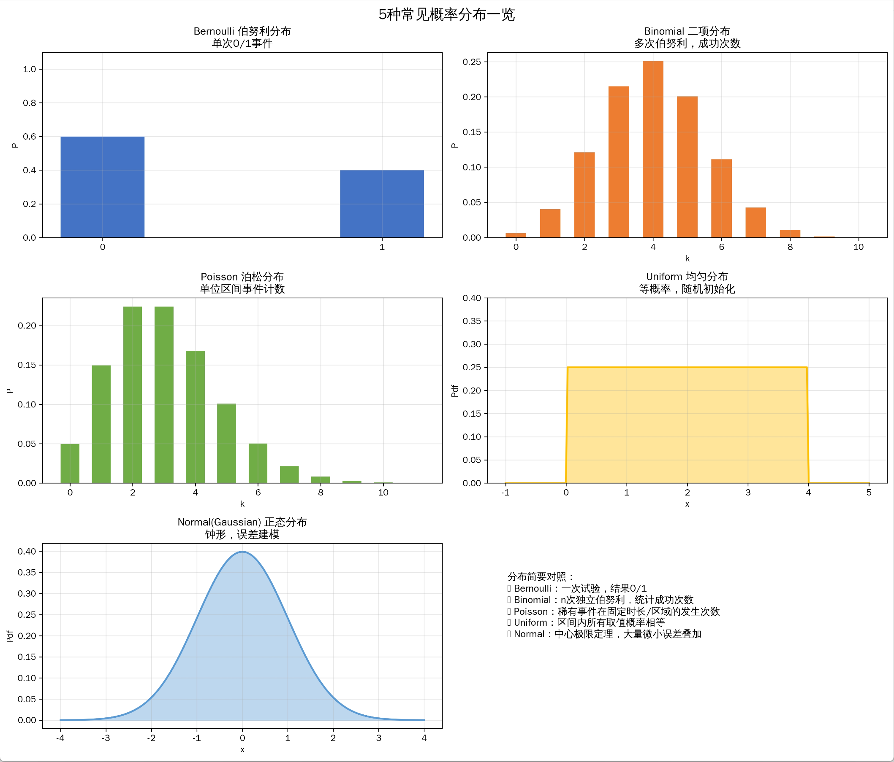

+++
author = "morningCPU"
title = "一天快速了解机器学习"
description = "MachineLearning"
date = 2026-11-18T19:42:40+08:00

readingtime = false

categories = ["AI"]
tags = ["AI"]

slug = "003"

series = []
aliases = []

draft = false
+++

## 0. 学习内容

> 1. 机器学习基本概念
> 2. 数学基础与优化
> 3. 经典机器学习算法
> 4. 基础学习与无监督学习
> 5. 深度学习基础
> 6. 模型训练与评估
> 7. 研究前沿与应用
> 8. 总结与讨论

## 1. 机器学习基本概念

### 1.0 学习清单

- [ ] Machine Learning 的定义和基本原理
- [ ] AI、Machine Learning、Deep Learning 的关系
- [ ] 传统编程与机器学习的区别
- [ ] 数据集（Dataset）
- [ ] 特征（Features）与标签（Labels）
- [ ] 样本（Samples）
- [ ] 模型（Model）
- [ ] 参数（Parameters）与超参数（Hyperparameters）
- [ ] 训练集、验证集、测试集
- [ ] Training、Validation、Inference 的区别
- [ ] 模型泛化能力（Generalization）

### 1.1 ML (Machine Learning) 

人工智能的分支，让机器能够学习到数据规律，并通过学习到的规律进行预测，而不用人为的硬编码设定具体规则。

>举一个简单的例子。
>
>假设我们希望计算机识别一封邮件是否为垃圾邮件。
>
>**传统编程方式：**
>
>人工设定规则：
>
>- 如果包含大量广告词，标记为垃圾邮件。
>- 如果包含可疑链接，标记为垃圾邮件。
>- 如果发件人属于黑名单，标记为垃圾邮件。
>
>程序按照人工制定的规则判断。
>
>**机器学习方式：**
>
>1. 收集大量邮件。
>2. 给邮件标记 Spam 或 Not Spam。
>3. 把邮件数据输入模型。
>4. 模型从数据中学习垃圾邮件的特征。
>5. 使用训练好的模型判断新邮件。
>
>

+ 人工预测 ： 输入 + 规则 得到结果，这个规则是人总结的
+ 机器预测 ： 输入 + 相应结果 得到规则，进而可以通过得到的规则去进行预测，这个规则是机器自己学习的

### 1.2 AI、ML、DL的关系

+ AI ： **让机器有人类智能**
+ ML：让机器通过**数据学习**的方式有人类智能
+ DL：让机器通过**多层神经网络学习**这种数据学习的方式有人类智能

### 1.3 ML的主要方式

+ 监督学习
+ 无监督学习
+ 强化学习

#### 1.3.1 监督学习

有标签的学习
使用有预测结果的数据进行学习

> 比如通过房屋面积和房间数量预测房价这个任务
> 训练数据中本身就有房价信息

**监督学习主要有两种**

**(1) 分类**

预测输入数据属于哪个类别

> - 邮件是垃圾邮件还是正常邮件。
> - 图片是猫还是狗。
> - 患者是否患有某种疾病。

输出是离散的

> 常见算法：Logistic Regression、SVM

**(2) 回归**

预测一个连续数值，也就是拟合

> - 房价预测。
> - 股票价格预测。
> - 温度预测。
> - 销售额预测。

输出是连续的

> 常用算法：Linear Regression、Random Forest Regressor

+ 可见有监督学习都是对结果有一定预期的，知道结果基本会是什么样子有什么标签，在意的一个确切的结果

#### 1.3.2 无监督学习

使用的数据是没有对应答案的，只是想要知道数据中存在的某种规律、划分

> 例如：用户分群。
>
> 一家电商公司有 10,000 名用户，但没有提前给用户分类。
>
> 模型根据：
>
> - 消费金额
> - 购买频率
> - 浏览行为
> - 商品偏好
>
> 自动将用户划分为不同群体。
>
> 

**主要是有以下几类**

**(1) 聚类**

把相似的放一起

> 常用算法：K-Means、DBSCAN、Hierarchical Clustering

**(2) 降维**

将高维信息映射到更低维，同时保留重要信息

> 常用算法：PCA、t-SNE、UMAP

**(3) 关联规则学习**

发现不同项目之间的关联

> 购买面包的用户经常也会购买牛奶。

> 常用算法：Apriori、FP-Growth

#### 1.3.3 强化学习

通过与环境进行交互，根据奖励和惩罚来学习最优决策

主要的组成如下：

| 概念        | 含义       |
| ----------- | ---------- |
| Agent       | 智能体     |
| Environment | 环境       |
| State       | 当前状态   |
| Action      | 执行的动作 |
| Reward      | 奖励       |
| Policy      | 决策策略   |

> 举例：训练机器人走路。
>
> 1. Robot（Agent）尝试迈出一步。
> 2. Environment 提供反馈。
> 3. 如果机器人保持平衡，获得正奖励。
> 4. 如果机器人摔倒，获得负奖励。
> 5. Agent 根据反馈调整策略。
> 6. 重复训练，最终学会稳定行走。

> 常用算法：Q-Learning、DQN、Policy Gradient、Actor-Critic、PPO

+ 可见监督学习是学习一个得到结果的方法
+ 无监督学习是学习规律与分布本身
+ 强化学习是学习一个行动的策略

### 1.4 机器学习核心术语

**数据集**
用于机器学习的数据集合

**样本**
一条独立的数据记录

**特征**
样本的输入变量

> 比如对于房价预测：Area、Number of Bedrooms、Location ...

数学表示 $X = (x_1,x_2, \dots,x_n)$

**标签/目标**
监督学习中希望模型预测的正确答案，一般用 $y$ 表示

**模型**

从数据中学习到的输入和输出关系的函数

$$
\hat{y} = f_\theta(X)
$$

**参数**
模型在训练过程中通过数据学习的变量(或者说变量的取值)

> 例如对于一个线性回归模型：

$$
\hat{y} = wx + b
$$

> 模型会学习 $w,b$ 的值，从而得到这个函数，这个就是模型

模型训练的过程就是对参数的取值不对进行优化，尽可能符合要求

**超参数**
在训练前确定的，不由训练改变的参数，一般是人为确定或调参得到

### 1.5 数据划分

数据通常划分为三个部分
训练集、验证集、测试集
比例一般是8:1:1,根据需求而定

**(1) 训练集**
用于模型的训练

**(2) 验证集**
用于模型的选择和调试

**(3) 测试集**
用于最终的测试工作

### 1.6 泛化能力

模型在没有参与训练的新数据上，仍然能够保持良好预测表现的能力
模型真正学习到数据的本质特征而不只是一些特殊的特征

**(1) 欠拟合**
没有学习到数据特征
表现为训练集和测试集的表现都不好

**(2) 过拟合**
过渡训练，泛化能力不足
表现为训练集表现好，测试集表现不好

**(3) 良好拟合**
学习到数据的本质特征，泛化能力好
在训练集和测试集上的表现都好

### 1.7 机器学习项目的工作过程

下面以一般性的监督学习为例

1. 问题定义
2. 收集数据
3. 打标签
4. 缺失值、异常值处理
5. 特征工程
6. 数据集划分
7. 模型选择
8. 模型训练
9. 模型调整
10. 模型测试
11. 模型部署
12. 使用

### 1.8 问题

1. 监督学习和无监督学习有什么区别？
2. 分类和回归有什么区别？
3. 为什么机器学习需要训练集、验证集和测试集？
4. 什么是模型泛化能力？

## 2. 数学基础

### 2.0 清单

- [ ] 线性代数-数据表示、降维 :  Vector、Matrix、Matrix Multiplication、Eigenvalues、Eigenvectors
- [ ] 微积分-参数优化 : Derivative、Partial Derivative、Chain Rule、Gradient
- [ ] 概率论-概率预测 : Probability、Conditional Probability、Bayes' Theorem
- [ ] 统计学-数据分析 : Mean、Variance、Covariance、Distribution
- [ ] 优化理论-模型训练 : Gradient Descent、Learning Rate、Loss Function

### 2.1 线性代数

主要就是各种矩阵运算，通过矩阵可以对数据进行更加快速和便捷的处理

> 例如：
>
> 你有一个学生的数据：
>
> | 学生 | 数学成绩 | 英语成绩 | 学习时长 |
> | ---- | -------- | -------- | -------- |
> | A    | 90       | 85       | 5        |
> | B    | 80       | 92       | 4        |
> | C    | 70       | 78       | 3        |
>
> 这些数据可以表示为一个矩阵：
>
> $X= \begin{bmatrix} 90&85&5\\ 80&92&4\\ 70&78&3 \end{bmatrix}$

注意一下以下几个概念的对比，主要就是维度的不同

| 中文 | 阶数 (Rank)  | Shape 示例      | 说明                  |
| ---- | ------------ | --------------- | --------------------- |
| 标量 | 0 阶张量     | `()`            | 单个数字，如 loss=2.1 |
| 向量 | 1 阶张量     | `(5,)`          | 一维数组              |
| 矩阵 | 2 阶张量     | `(3,4)`         | 行、列两个维度        |
| 张量 | 0/1/2/3/… 阶 | `(2,3,224,224)` | 任意阶多维数组统称    |

#### 2.1.1 向量

用于表示一个样本或特征

一个样本可以表示为：

$$
\mathbf{x} = [x_1,x_2,\dots,x_n]
$$

> 注意前面的 **x** 加粗表示向量，后面的 $x_i$ 没有加粗是标量

其中：

- $x_i$：第 i个特征
- n ：特征数量

**向量的常见操作**

**(1) 向量加法**

$$
\mathbf{a} + \mathbf{b}
$$

**(2) 向量数乘**

$$
c\mathbf{a}
$$

**(3) 向量长度(L2 Norm L2范数，就是欧几里得距离)**

$$
\|\mathbf{x}\|_2=
\sqrt{\sum_{i=1}^{n}x_i^2}
$$

> 例如：$\mathbf{x}=[3,4]$ , 则：$\|\mathbf{x}\|_2=\sqrt{3^2+4^2}=5$

#### 2.1.2 点积

对 $\mathbf{x}=[x_1,x_2,\dots,x_n]$ 和 $\mathbf{w}=[w_1,w_2,\dots,w_n]$

$\mathbf{x}\cdot\mathbf{w}=\sum_{i=1}^{n}{x_iw_i}$

> 例如：$\mathbf{x}=[2,3] , \mathbf{w}=[4,5]$
> 则：$\mathbf{x}\cdot\mathbf{w}=2\times4+3\times5=23$
> 就是分别相乘再相加

#### 2.1.3 矩阵

矩阵有行和列，行表示样本，列表示特征

**(1) 矩阵乘法**

如果：$A\in\mathbb R^{m\times n}​$ ，$B\in\mathbb R^{n\times p}​$
那么：$AB\in\mathbb R^{m\times p}​$

必须满足：**第一个矩阵的列数 = 第二个矩阵的行数。**

如果不了解可以搜索相关视频，这里不详细解释具体运算细节

矩阵乘法的作用主要就是便捷进行大批量的计算

**(2) 转置**

就是将行列交换

>  例如：

$$
A = \begin{bmatrix} 1&2\\ 3&4\\ 5&6 \end{bmatrix},
\quad
A^T = \begin{bmatrix} 1&3&5\\ 2&4&6 \end{bmatrix}
$$

**(3) 特征值和特征向量**

$\mathbf{A}\mathbf v=\lambda\mathbf v$

其中：

- $\mathbf{A}$：矩阵
- $\mathbf v​$：特征向量
- $\lambda$：特征值

矩阵变换作用在某个特定方向的向量上时，向量方向保持不变，只改变长度
就是说这个特征向量表示了一系列矩阵的本质特征，而特征值固定了一个特定的矩阵

## 2.2 微积分

主要是反向传播的更新部分发挥作用

用于确定每个参数对损失需要负责多少

#### 2.2.1 导数

描述一个函数变化的速度

直观上导数表示 ：**当输入x 发生微小变化时，函数f(x)会变化多少**

在机器学习中，变化的量只有参数 $\theta$
模型的预测结果和计算得到的损失 $L(\theta)$ 取决于这些参数 
我们想要知道怎么能够将损失 $L(\theta)$ 减小
那么我们就需要知道参数 $\theta$ 的变化对损失 $L(\theta)$ 的影响
这个时候就需要导数了

通过

$$
\frac{dL}{d\theta}
$$

我们可以知道
如果导数为正，增加参数可能会增加 Loss。
如果导数为负，增加参数可能会减少 Loss。
因此，导数为模型参数的更新提供方向信息。

> 这里说可能是因为导数只是保证很微小的一段距离的变化的趋势，我们并不知道这个距离到底是多少

#### 2.2.2 偏导数

表示只改变一个变量，其他变量保持不变时，函数如何变化
就是要知道每一个变量的影响，从而可以进行个性化的调整
具体运算就是把其他变量当成常量就好

**(1) 梯度**

由所有偏导数组成的向量
在机器学习中表示为 $\nabla_\theta L(\theta)$
表示 Loss 对模型参数的梯度

**(2) 链式法则**

主要就是用于对各个参数求偏导，了解一下就好，使用库会自动计算

深度神经网络由多个函数包裹组成

$$
\begin{aligned}
\hat{y} &= f_3(f_2(f_1(x))) \\
f_1 &= w_1x
\end{aligned}
$$

想要求参数 $w_1$ 的偏导的话：

$$
\begin{aligned}
\frac{\partial L}{\partial w_1}
&= \frac{\partial L}{\partial \hat y}
\cdot \frac{\partial \hat y}{\partial h_2}
\cdot \frac{\partial h_2}{\partial h_1}
\cdot \frac{\partial h_1}{\partial w_1}
\end{aligned}
$$

其中 $h_i$ 表示 $w_1$ 所在的那个公式
具体计算与原因不详细解释，可以自行学习

## 2.3 概率论

主要就是各种基础算法，一些机器学习算法是基于一些基本概率论算法的

#### 2.3.1 基本概率

概率： $P(A)$

#### 2.3.2 条件概率

$$
P(A|B)=\frac{P(A\cap B)}{P(B)}
$$

表示在事件B发生的前提下A发生的概率

#### 2.3.3 贝叶斯定理

根据先验概率求后验概率

$$
P(A|B)=\frac{P(B|A)P(A)}{P(B)}
$$

其中：

| 符号    | 含义                |
| ------- | ------------------- |
| P(A)    | Prior，先验概率     |
| P(B\|A) | Likelihood，似然    |
| P(A\|B) | Posterior，后验概率 |
| P(B)    | Evidence，证据      |

直观地理解是就是，本来有A，知道A的概率P(A)
后面又有了一个新的证据B,我们想要知道在新加上这个证据B后的概率
那么就是在B发生的基础上(除P(B))，A发生的概率
但是这里使用的不是 $P(A\cap B)$ 而是 $P(B|A)P(A)$
使用释然函数 $P(B|A)$ 表示的是B导致A发生的可能
整体就是 $\frac{P(B|A)P(A)}{P(B)}$

> 条件概率和贝叶斯表示的意思相同，就一个用的是同时发生的概率，一个在不知道同时发生的概率的情况下用释然函数进行估计
>
> 两者的数学含义是相同的，主要就是看你有的条件和数据

#### 2.3.4 常见概率分布

| 分布                | 特点           | 应用         |
| ------------------- | -------------- | ------------ |
| 伯努利分布(0/1分布) | 单次 0/1 事件  | 二分类       |
| 二项式分布          | 多次 Bernoulli | 成功次数     |
| 正态分布            | 钟形分布       | 误差建模     |
| 均匀分布            | 均匀分布       | 随机初始化等 |
| 泊松分布            | 事件发生次数   | 计数数据     |

**正态分布**

$$
X\sim N(\mu,\sigma^2)
$$

其中：

- $\mu$：均值
- $\sigma^2$：方差

#### 2.3.5 最大释然估计

MLE (Maximum Likelihood Estimation)

目标是寻找最可能产生当前观察数据的参数

假设数据：$D=\{x_1,x_2,\dots,x_n\}$

参数：$\theta$

Likelihood：$L(\theta)=P(D|\theta)$

我们希望：$\hat\theta= \arg\max_\theta P(D|\theta) $

通常使用 Log-Likelihood：

$\hat\theta= \arg\max_\theta\log P(D|\theta) $

> 将乘积变为求和，并且数据更加稳定

