+++
author = "morningCPU"
title = "一天快速了解机器学习"
description = "MachineLearning"
date = 2026-11-18T19:42:40+08:00

readingtime = false

categories = ["AI"]
tags = ["AI"]

slug = "003"

series = []
aliases = []

draft = false

+++


# 一天快速了解机器学习

## 0. 学习内容

> 1. 机器学习基本概念
> 2. 数学基础与优化
> 3. 经典机器学习算法
> 4. 基础学习与无监督学习
> 5. 深度学习基础
> 6. 模型训练与评估
> 7. 研究前沿与应用
> 8. 总结与讨论


## 1. 机器学习基本概念

### 1.0 学习清单

- [ ] Machine Learning 的定义和基本原理
- [ ] AI、Machine Learning、Deep Learning 的关系
- [ ] 传统编程与机器学习的区别
- [ ] 数据集（Dataset）
- [ ] 特征（Features）与标签（Labels）
- [ ] 样本（Samples）
- [ ] 模型（Model）
- [ ] 参数（Parameters）与超参数（Hyperparameters）
- [ ] 训练集、验证集、测试集
- [ ] Training、Validation、Inference 的区别
- [ ] 模型泛化能力（Generalization）

### 1.1 ML (Machine Learning) 

人工智能的分支，让机器能够学习到数据规律，并通过学习到的规律进行预测，而不用人为的硬编码设定具体规则。

>举一个简单的例子。
>
>假设我们希望计算机识别一封邮件是否为垃圾邮件。
>
>**传统编程方式：**
>
>人工设定规则：
>
>- 如果包含大量广告词，标记为垃圾邮件。
>- 如果包含可疑链接，标记为垃圾邮件。
>- 如果发件人属于黑名单，标记为垃圾邮件。
>
>程序按照人工制定的规则判断。
>
>**机器学习方式：**
>
>1. 收集大量邮件。
>2. 给邮件标记 Spam 或 Not Spam。
>3. 把邮件数据输入模型。
>4. 模型从数据中学习垃圾邮件的特征。
>5. 使用训练好的模型判断新邮件。
>
>

+ 人工预测 ： 输入 + 规则 得到结果，这个规则是人总结的
+ 机器预测 ： 输入 + 相应结果 得到规则，进而可以通过得到的规则去进行预测，这个规则是机器自己学习的

### 1.2 AI、ML、DL的关系


+ AI ： **让机器有人类智能**
+ ML：让机器通过**数据学习**的方式有人类智能
+ DL：让机器通过**多层神经网络学习**这种数据学习的方式有人类智能

### 1.3 ML的主要方式

+ 监督学习
+ 无监督学习
+ 强化学习

#### 1.3.1 监督学习

有标签的学习
使用有预测结果的数据进行学习

> 比如通过房屋面积和房间数量预测房价这个任务
> 训练数据中本身就有房价信息


**监督学习主要有两种**

**(1) 分类**

预测输入数据属于哪个类别

> - 邮件是垃圾邮件还是正常邮件。
> - 图片是猫还是狗。
> - 患者是否患有某种疾病。

输出是离散的

> 常见算法：Logistic Regression、SVM


**(2) 回归**

预测一个连续数值，也就是拟合

> - 房价预测。
> - 股票价格预测。
> - 温度预测。
> - 销售额预测。

输出是连续的

> 常用算法：Linear Regression、Random Forest Regressor


+ 可见有监督学习都是对结果有一定预期的，知道结果基本会是什么样子有什么标签，在意的一个确切的结果

#### 1.3.2 无监督学习

使用的数据是没有对应答案的，只是想要知道数据中存在的某种规律、划分

> 例如：用户分群。
>
> 一家电商公司有 10,000 名用户，但没有提前给用户分类。
>
> 模型根据：
>
> - 消费金额
> - 购买频率
> - 浏览行为
> - 商品偏好
>
> 自动将用户划分为不同群体。
>
> 

**主要是有以下几类**

**(1) 聚类**

把相似的放一起

> 常用算法：K-Means、DBSCAN、Hierarchical Clustering

**(2) 降维**

将高维信息映射到更低维，同时保留重要信息

> 常用算法：PCA、t-SNE、UMAP


**(3) 关联规则学习**

发现不同项目之间的关联

> 购买面包的用户经常也会购买牛奶。

> 常用算法：Apriori、FP-Growth

#### 1.3.3 强化学习

通过与环境进行交互，根据奖励和惩罚来学习最优决策

主要的组成如下：

| 概念        | 含义       |
| ----------- | ---------- |
| Agent       | 智能体     |
| Environment | 环境       |
| State       | 当前状态   |
| Action      | 执行的动作 |
| Reward      | 奖励       |
| Policy      | 决策策略   |

> 举例：训练机器人走路。
>
> 1. Robot（Agent）尝试迈出一步。
> 2. Environment 提供反馈。
> 3. 如果机器人保持平衡，获得正奖励。
> 4. 如果机器人摔倒，获得负奖励。
> 5. Agent 根据反馈调整策略。
> 6. 重复训练，最终学会稳定行走。

> 常用算法：Q-Learning、DQN、Policy Gradient、Actor-Critic、PPO

+ 可见监督学习是学习一个得到结果的方法
+ 无监督学习是学习规律与分布本身
+ 强化学习是学习一个行动的策略

### 1.4 机器学习核心术语

**数据集**
用于机器学习的数据集合

**样本**
一条独立的数据记录

**特征**
样本的输入变量

> 比如对于房价预测：Area、Number of Bedrooms、Location ...

数学表示 $X = (x_1,x_2, \dots,x_n)$

**标签/目标**
监督学习中希望模型预测的正确答案，一般用 $y$ 表示

**模型**
从数据中学习到的输入和输出关系的函数
$$
\hat{y} = f_\theta(X)
$$

**参数**
模型在训练过程中通过数据学习的变量(或者说变量的取值)
> 例如对于一个线性回归模型
> $$
> \hat{y} = wx + b
> $$
> 模型会学习 $w,b$ 的值，从而得到这个函数，这个就是模型

模型训练的过程就是对参数的取值不对进行优化，尽可能符合要求

**超参数**
在训练前确定的，不由训练改变的参数，一般是人为确定或调参得到

### 1.5 数据划分

数据通常划分为三个部分
训练集、验证集、测试集
比例一般是8:1:1,根据需求而定

**(1) 训练集**
用于模型的训练

**(2) 验证集**
用于模型的选择和调试

**(3) 测试集**
用于最终的测试工作

### 1.6 泛化能力

模型在没有参与训练的新数据上，仍然能够保持良好预测表现的能力
模型真正学习到数据的本质特征而不只是一些特殊的特征

**(1) 欠拟合**
没有学习到数据特征
表现为训练集和测试集的表现都不好

**(2) 过拟合**
过渡训练，泛化能力不足
表现为训练集表现好，测试集表现不好

**(3) 良好拟合**
学习到数据的本质特征，泛化能力好
在训练集和测试集上的表现都好

### 1.7 机器学习项目的工作过程

下面以一般性的监督学习为例

1. 问题定义
2. 收集数据
3. 打标签
4. 缺失值、异常值处理
5. 特征工程
6. 数据集划分
7. 模型选择
8. 模型训练
9. 模型调整
10. 模型测试
11. 模型部署
12. 使用

### 1.8 问题

+ 监督学习和无监督学习有什么区别？

+ 分类和回归有什么区别？

+ 为什么机器学习需要训练集、验证集和测试集？

+ 什么是模型泛化能力？


## 2. 数学基础

### 2.0 清单

- [ ] 线性代数-数据表示、降维 :  Vector、Matrix、Matrix Multiplication、Eigenvalues、Eigenvectors
- [ ] 微积分-参数优化 : Derivative、Partial Derivative、Chain Rule、Gradient
- [ ] 概率论-概率预测 : Probability、Conditional Probability、Bayes' Theorem
- [ ] 统计学-数据分析 : Mean、Variance、Covariance、Distribution
- [ ] 优化理论-模型训练 : Gradient Descent、Learning Rate、Loss Function

### 2.1 线性代数

主要就是各种矩阵运算，通过矩阵可以对数据进行更加快速和便捷的处理

> 例如：
>
> 你有一个学生的数据：
>
> | 学生 | 数学成绩 | 英语成绩 | 学习时长 |
> | ---- | -------- | -------- | -------- |
> | A    | 90       | 85       | 5        |
> | B    | 80       | 92       | 4        |
> | C    | 70       | 78       | 3        |
>
> 这些数据可以表示为一个矩阵：
>
> $X= \begin{bmatrix} 90&85&5\\ 80&92&4\\ 70&78&3 \end{bmatrix}$

注意一下以下几个概念的对比，主要就是维度的不同

| 中文 | 阶数 (Rank)  | Shape 示例      | 说明                  |
| ---- | ------------ | --------------- | --------------------- |
| 标量 | 0 阶张量     | `()`            | 单个数字，如 loss=2.1 |
| 向量 | 1 阶张量     | `(5,)`          | 一维数组              |
| 矩阵 | 2 阶张量     | `(3,4)`         | 行、列两个维度        |
| 张量 | 0/1/2/3/… 阶 | `(2,3,224,224)` | 任意阶多维数组统称    |

#### 2.1.1 向量

用于表示一个样本或特征

一个样本可以表示为：
$$
\mathbf{x} = [x_1,x_2,\dots,x_n]
$$

> 注意前面的 **x** 加粗表示向量，后面的 $x_i$ 没有加粗是标量

其中：

- $x_i$：第 i个特征
- n ：特征数量

**向量的常见操作**

**(1) 向量加法**
$$
\mathbf{a} + \mathbf{b}
$$
**(2) 向量数乘**
$$
c\mathbf{a}
$$
**(3) 向量长度(L2 Norm L2范数，就是欧几里得距离)**
$$
\|\mathbf{x}\|_2=
\sqrt{\sum_{i=1}^{n}x_i^2}
$$

> 例如：$\mathbf{x}=[3,4]$ , 则：$\|\mathbf{x}\|_2=\sqrt{3^2+4^2}=5$

#### 2.1.2 点积

对 $\mathbf{x}=[x_1,x_2,\dots,x_n]$ 和 $\mathbf{w}=[w_1,w_2,\dots,w_n]$

$\mathbf{x}\cdot\mathbf{w}=\sum_{i=1}^{n}{x_iw_i}$

> 例如：$\mathbf{x}=[2,3] , \mathbf{w}=[4,5]$
> 则：$\mathbf{x}\cdot\mathbf{w}=2\times4+3\times5=23$
> 就是分别相乘再相加

#### 2.1.3 矩阵

矩阵有行和列，行表示样本，列表示特征

**(1) 矩阵乘法**

如果：$A\in\mathbb R^{m\times n}​$ ，$B\in\mathbb R^{n\times p}​$
那么：$AB\in\mathbb R^{m\times p}​$

必须满足：**第一个矩阵的列数 = 第二个矩阵的行数。**

如果不了解可以搜索相关视频，这里不详细解释具体运算细节

矩阵乘法的作用主要就是便捷进行大批量的计算

**(2) 转置**

就是将行列交换

>  例如：
> $$
> A= \begin{bmatrix} 1&2\\ 3&4\\ 5&6 \end{bmatrix}
>  , 
> A^T= \begin{bmatrix} 1&3&5\\ 2&4&6 \end{bmatrix}
> $$

**(3) 特征值和特征向量**

$\mathbf{A}\mathbf v=\lambda\mathbf v$

其中：

- $\mathbf{A}$：矩阵
- $\mathbf v​$：特征向量
- $\lambda$：特征值

矩阵变换作用在某个特定方向的向量上时，向量方向保持不变，只改变长度
就是说这个特征向量表示了一系列矩阵的本质特征，而特征值固定了一个特定的矩阵

### 2.2 微积分

主要是反向传播的更新部分发挥作用

用于确定每个参数对损失需要负责多少

#### 2.2.1 导数

描述一个函数变化的速度

直观上导数表示 ：**当输入x 发生微小变化时，函数f(x)会变化多少**

在机器学习中，变化的量只有参数 $\theta$
模型的预测结果和计算得到的损失 $L(\theta)$ 取决于这些参数 
我们想要知道怎么能够将损失 $L(\theta)$ 减小
那么我们就需要知道参数 $\theta$ 的变化对损失 $L(\theta)$ 的影响
这个时候就需要导数了
通过 
$$
\frac{dL}{d\theta}
$$
我们可以知道
如果导数为正，增加参数可能会增加 Loss。
如果导数为负，增加参数可能会减少 Loss。
因此，导数为模型参数的更新提供方向信息。

> 这里说可能是因为导数只是保证很微小的一段距离的变化的趋势，我们并不知道这个距离到底是多少

#### 2.2.2 偏导数

表示只改变一个变量，其他变量保持不变时，函数如何变化
就是要知道每一个变量的影响，从而可以进行个性化的调整
具体运算就是把其他变量当成常量就好

**(1) 梯度**

由所有偏导数组成的向量
在机器学习中表示为 $\nabla_\theta L(\theta)$
表示 Loss 对模型参数的梯度

**(2) 链式法则**

主要就是用于对各个参数求偏导，了解一下就好，使用库会自动计算
深度神经网络由多个函数包裹组成
$$
\hat{y} = f_3(f_2(f_1(x)))\\
f_1 = w_1x
$$
想要求参数 $w_1$ 的偏导的话：
$$
\frac{\partial L}{\partial w_1}
=
\frac{\partial L}{\partial \hat y}
\frac{\partial \hat y}{\partial h_2}
\frac{\partial h_2}{\partial h_1}
\frac{\partial h_1}{\partial w_1}
$$
其中 $h_i$ 表示 $w_1$ 所在的那个公式
具体计算与原因不详细解释，可以自行学习

### 2.3 概率论

主要就是各种基础算法，一些机器学习算法是基于一些基本概率论算法的

#### 2.3.1 基本概率

概率： $P(A)​$

#### 2.3.2 条件概率

$$
P(A|B)=\frac{P(A\cap B)}{P(B)}
$$

表示在事件B发生的前提下A发生的概率


#### 2.3.3 贝叶斯定理

根据先验概率求后验概率
$$
P(A|B)=\frac{P(B|A)P(A)}{P(B)}
$$
其中：

| 符号    | 含义                |
| ------- | ------------------- |
| P(A)    | Prior，先验概率     |
| P(B\|A) | Likelihood，似然    |
| P(A\|B) | Posterior，后验概率 |
| P(B)    | Evidence，证据      |

直观地理解是就是，本来有A，知道A的概率P(A)
后面又有了一个新的证据B,我们想要知道在新加上这个证据B后的概率
那么就是在B发生的基础上(除P(B))，A发生的概率
但是这里使用的不是 $P(A\cap B)$ 而是 $P(B|A)P(A)$
使用释然函数 $P(B|A)$ 表示的是B导致A发生的可能
整体就是 $\frac{P(B|A)P(A)}{P(B)}$

> 条件概率和贝叶斯表示的意思相同，就一个用的是同时发生的概率，一个在不知道同时发生的概率的情况下用释然函数进行估计
>
> 两者的数学含义是相同的，主要就是看你有的条件和数据

#### 2.3.4 常见概率分布


| 分布                | 特点           | 应用         |
| ------------------- | -------------- | ------------ |
| 伯努利分布(0/1分布) | 单次 0/1 事件  | 二分类       |
| 二项式分布          | 多次 Bernoulli | 成功次数     |
| 正态分布            | 钟形分布       | 误差建模     |
| 均匀分布            | 均匀分布       | 随机初始化等 |
| 泊松分布            | 事件发生次数   | 计数数据     |

**正态分布**
$$
X\sim N(\mu,\sigma^2)
$$
其中：

- $\mu$：均值
- $\sigma^2$：方差

#### 2.3.5 最大释然估计

MLE (Maximum Likelihood Estimation)

目标是寻找最可能产生当前观察数据的参数

假设数据：$D=\{x_1,x_2,\dots,x_n\}$

参数：$\theta$

Likelihood：$L(\theta)=P(D|\theta)$

我们希望：$\hat\theta= \arg\max_\theta P(D|\theta) $

通常使用 Log-Likelihood：

$\hat\theta= \arg\max_\theta\log P(D|\theta) $

> 将乘积变为求和，并且数据更加稳定

### 2.4 统计学

获取、整合需要的信息，估计规律，判断结论是否可靠

#### 2.4.1 均值

$$
\mu=\frac{1}{n}\sum_{i=1}^{n}x_i
$$

>例如：[2,4,6,8] 
>均值：$\mu=5$

#### 2.4.2 方差 

方差描述的是数据的离散程度，也就是数据有多均匀
$$
\sigma^2=\frac{1}{n}\sum_{i=1}^{n}(x_i-\mu)^2
$$

> 每个值与平均值的差别的平方和的均值
> 有点像MSE求损失

#### 2.4.3 标准差

$$
\sigma=\sqrt{\sigma^2}
$$

主要的作用就是单位有意义和元数据使用相同的数据，更加直观

> 差不多相当于RMSE了是

#### 2.4.4 协方差

协方差用于看两个变量之间的关系
看一个变量变化，另一个变量是否也一起变化
$$
Cov(X,Y)=
\frac{1}{n}\sum_{i=1}^{n}(x_i-\mu_x)(y_i-\mu_y)
$$

> Cov > 0 : 倾向于同向变化
> Cov < 0 : 倾向于反向变化
> Cov ≈ 0 : 线性关系较弱

可以看到分割点在0,
协方差起作用的原因可以这么看
主要就是 $(x_i-\mu_x)(y_i-\mu_y)$
可以看到 $x_i$ 和 $y_i$ 都相对于各自的均值偏大/偏向时，为正(>0)
相对于各自的均值偏向不同是，为负(<0)
这些结果求均值看全部的平均变化倾向

#### 2.4.5 相关系数

$$
\rho_{XY}=
\frac{Cov(X,Y)}{\sigma_X\sigma_Y}
$$

取值：$-1\le\rho\le1​$

| 相关系数 | 含义       |
| -------- | ---------- |
| 1        | 完全正相关 |
| 0        | 无线性相关 |
| -1       | 完全负相关 |

+ 注意相关关系并不意味着因果关系
  A、B一起变化并不能说明是A导致B变化或B导致A变化
  也可能是有一个第三方C导致了这个关系
  或者是完全的巧合

#### 2.4.6 偏差与方差

**(1) 偏差**
模型预测值与真实值的差距
可能是模型太简单，无法捕获复杂规律，导致欠拟合

**(2) 方差**
模型对数据变化的敏感程度，泛化能力的体现
可能是模型太负责，多度拟合每一个数据点，导致过拟合

**(3) 偏差方差均衡**
$$
\mathbf{E}\big[(y-\hat{f}(x))^2\big]
=\text{Bias}^2(\hat{f}(x))
+\text{Var}(\hat{f}(x))
+\sigma^2
$$
其中：

- $\mathbf{E}\big[(y-\hat{f}(x))^2\big]$：期望测试误差（MSE，均方误差）
- $\text{Bias}^2$：偏差平方，模型本身拟合能力不足带来的误差（欠拟合）
- $\text{Var}​$：方差，模型在不同训练集上波动大（过拟合）
- $\sigma^2​$：固有噪声，数据本身的随机噪声，任何模型都消不掉

> 注意误差和噪声，误差可以减小，但是噪声本来就存在不可去除
> 比如传感器采集，温度、图像、传感器读数自带仪器误差

对这个公式简单理解就是
结果 = 偏差 + 方差 + 噪声(这个一般直接不考虑)
主要就是记住下面这个图就可以
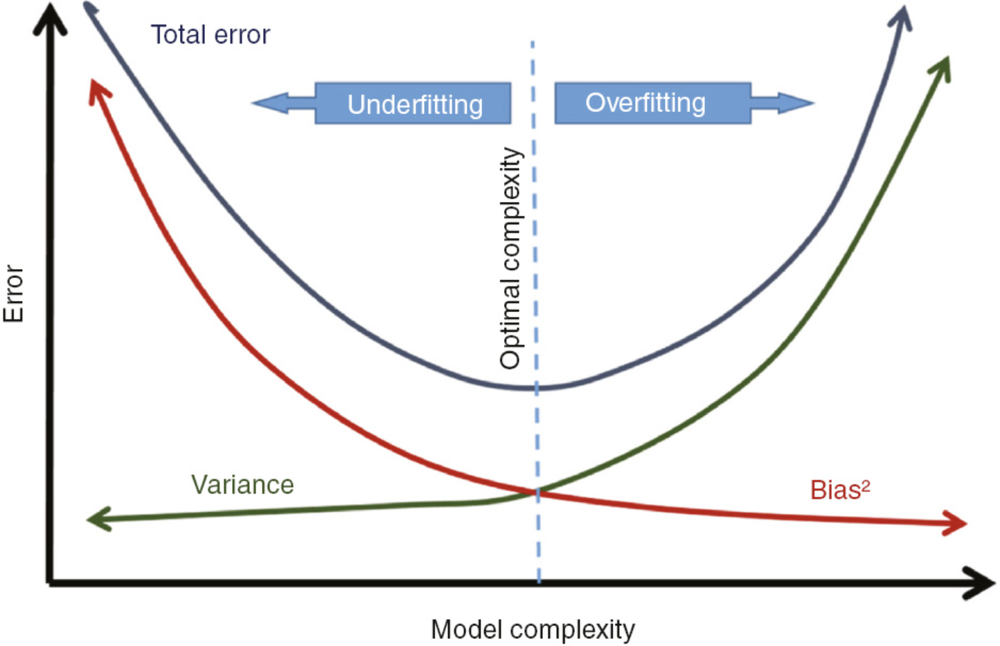

随着程度的加深，训练越来越多轮或者模型越来越复杂等等
偏差会降低，方差会加大
从而模型总的损失是先大后小再大
模型训练就是为了找到这个最低点

### 2.4 优化理论

机器学习训练的本质目标就是寻找一个最优的参数使模型预测的损失最小

#### 2.4.1 梯度下降

更新公式：
$$
\theta_{t+1}=\theta_t-\eta\nabla_\theta L(\theta_t)
$$
其中：

- $\theta_t​$：当前参数
- $\eta$：学习率
- $\nabla L$：梯度
- $\theta_{t+1}$：更新后的参数

这里有几个点
首先是**梯度**，顺着梯度走就是上升最快的方向
所以我们这里需要反着走使用减去，这样就是使损失下降最快的方向
有了方向我们还需要知道朝着这个方向走多远，这个的把控就是**学习率**
前面说了，梯度或者说导数，他只能判断一段很小的变化对结果的影响，所以这个走的距离不能太大，不然就不准了，也不能太小，不然走的太慢了(这里是直观的理解，下面还会详细解释一下)
通过梯度更新就实现了参数的自动更新

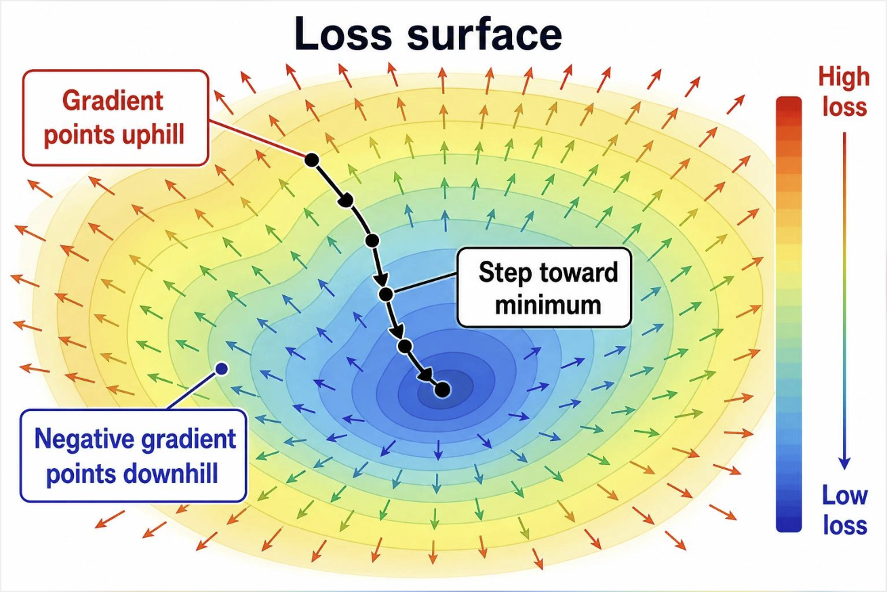

#### 2.4.2 学习率

Learning Rate

学习率决定每次更新的步长
$$
\theta_{t+1}=\theta_t-\eta\nabla L
$$
下面看不同学习率的影响

**(1) LR过大**

Loss震荡，越过最优点，甚至无法收敛

**(2) LR过小**

训练过慢
还有就是局部最优的情况下，较大的LR可能会越过，而较小的LR就会困于这个局部最优

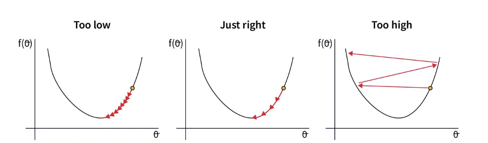

#### 2.4.3 梯度下降-训练数据选择
**(1) 批量梯度下降**

BGD ：Batch Gradient Descent

这里注意批量的意思，不是说选一部分，指的是全部
每次更新参数时都使用**全部**训练数据
$$
\nabla L=\frac{1}{n}\sum_{i=1}^{n}\nabla\ell_i
$$
其中 $\nabla\ell_i​$ 是第i个样本的损失
**优点**：梯度稳定
**缺点**：计算成本高，内存需求大

**(2)  随机梯度下降**

SGD : Stochastic Gradient Descent

每次只使用**一个**样本更新参数
**优点** ：计算快
**缺点** ：更新噪声大，Loss可能震荡

**(3) 小批量梯度下降**

Mini-batch Gradient Descent

+ 注意很多地方说的SGD其实指的是小批量梯度下降

每次使用一小批样本
效果和需求更加平衡，最常用

#### 2.4.4 梯度下降-优化器

优化器的意思就是对参数进行优化的工具，其实就是上面的梯度下降公式，这个梯度下降的方式有很多
这里只用了解一下就好，知道都有什么优化就好，不用太在意公式

**(1) SGD**
基础梯度下降方法
$$
\theta_{t+1}=\theta_t-\eta g_t
$$
**(2) Momentum**
动量，就是相当于惯性，让变化更加连续性的感觉，前面的会对后面的产生影响
通过累积过去梯度，减少震荡并加速优化。
$$
v_t=\beta v_{t-1}+g_t \\
\theta_{t+1}=\theta_t-\eta v_t
$$

> $\beta  、 \eta$ 都是超参数

**(3) Adam**
最常用的
结合Momentum和自适应学习率
$$
m_t=\beta_1m_{t-1}+(1-\beta_1)g_t
\\
v_t=\beta_2v_{t-1}+(1-\beta_2)g_t^2
\\
\theta_{t+1}=\theta_t-\eta\frac{\hat m_t}{\sqrt{\hat v_t}+\epsilon}
$$

> $\eta,\ \beta_1,\ \beta_2,\ \epsilon$ 都是超参数

其中 $\sqrt{\hat v_t}+\epsilon​$ 让每个参数都有了它自己的缩放系数对学习率进行调整

> 这个 $\epsilon$ 基本就是为了防止除零，一个很小的常数

利用历史梯度信息，并根据梯度大小调整不同参数的跟新步长
效果一般最好

### 2.5 问题

- 为什么机器学习数据用向量和矩阵表示？
- 什么是模型参数？
- 什么是 Loss Function？
- 为什么需要 Gradient？
- Gradient Descent 如何更新参数？
- 为什么神经网络使用 Backpropagation？
- 什么是概率和条件概率？
- Bayes' Theorem 如何用于机器学习？
- 什么是 Mean、Variance、Covariance？
- 什么是 Bias-Variance Tradeoff？
- Adam 和 SGD 有什么区别？


## 3. 经典机器学习算法

### 3.1 监督学习算法

#### 3.1.1 线性回归

Linear Regression

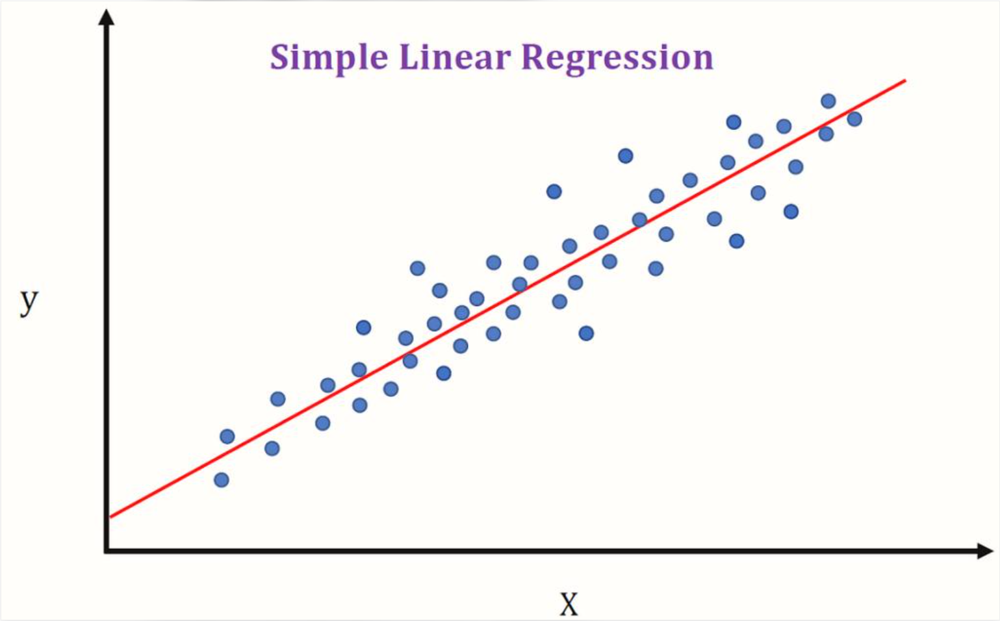

通过建立输入特征与输出结果之间的线性关系，预测连续数值
$$
\hat y=w_1x_1+w_2x_2+\cdots+w_nx_n+b\\
$$
矩阵形式：
$$
\hat y=Xw+b
$$

+ 求解使用最小二乘法或梯度下降

误差：

+ MSE

> 线性回归经常被用作Baseline
> 这是因为它简单、可解释、计算成本低

 [code_LinearRegression.html](code\code_LinearRegression.html) 

+ sklearn.linear_model.LinearRegression 使用的是最小二乘法直接进行求解

#### 3.1.2 逻辑回归

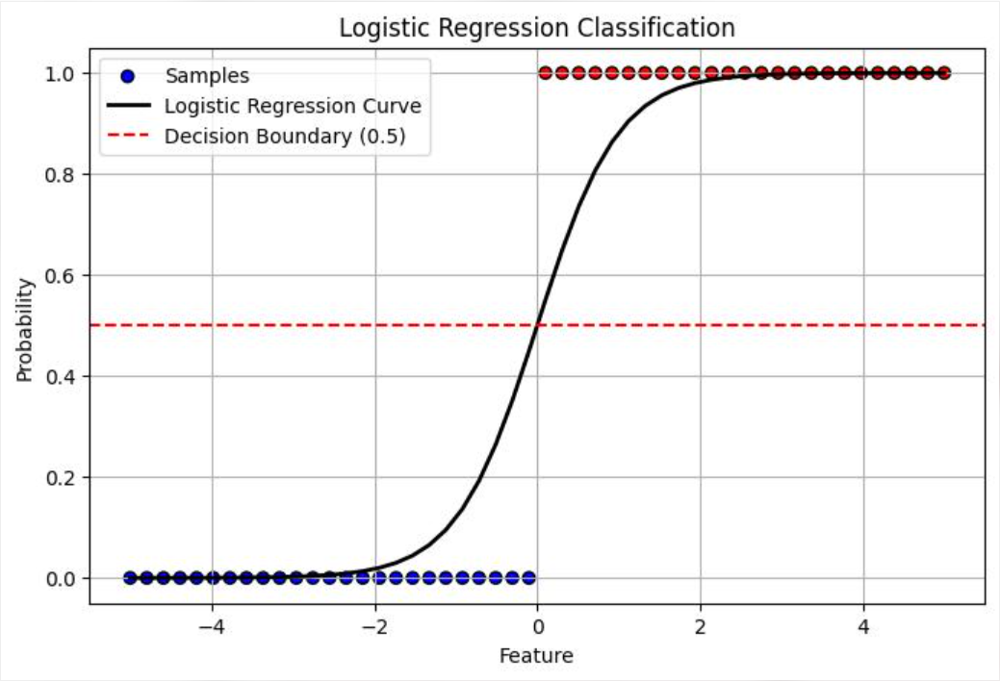

LogisticRegression

虽然是叫回归，但是是用于分类任务
$$
z=w^Tx+b \\
\sigma(z)=\frac{1}{1+e^{-z}}
$$
是一个线性回归的函数加上了一个sigmoid,所以有了回归这个名字，通过线性回归函数做二分类问题

想要知道样本属于类别1的概率：$P(y=1|x)​$
我们定义 $P(y=1|x)=\sigma(w^Tx+b)​$
这个是人为定义，就认为$P(y=1|x)​$可以用$\sigma(w^Tx+b)​$表示

**误差：**

BCE : Binary Cross-Entropy 二元交叉熵
$$
L=-\frac1n\sum_{i=1}^n
[y_i\log(\hat y_i)
+(1-y_i)\log(1-\hat y_i)]
$$

+ 能够衡量模型预测概率与真实类别之间的差距

 [code_LogisticRegression.html](code\code_LogisticRegression.html) 

#### 3.1.3 K近邻

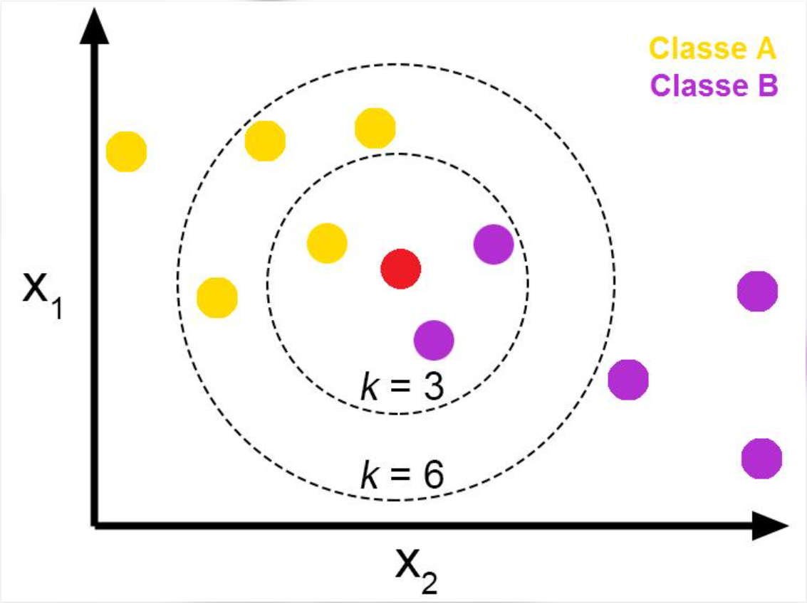

K-Neareset Neighbors

+ 一个样本的类别通常与它附近的样本的类别有关

> 例如：
> 我们想判断一个新用户属于哪类客户。
> 观察附近的 5 个用户：
>
> - 3 个属于 A 类
> - 2 个属于 B 类
>
> 那么新用户被分类为 A 类。

使用欧式距离
$$
d(x,y)=\sqrt{\sum_{i=1}^{n}(x_i-y_i)^2}
$$

+ KNN通常需要对样本的特征进行标准化
  因为如果一个特征的取值很大，另一个相对较小，那么对欧氏距离的计算来说，就基本是第一个特征在起作用了

 [code_KNeighborsClassifier.html](code\code_KNeighborsClassifier.html) 

#### 3.1.4 朴素贝叶斯

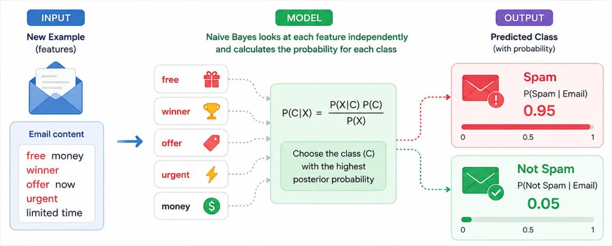

基于贝叶斯定理的概率分类算法
根据样本的特征，计算它属于不同类别的概率，选择概率最大的类别

> 会假设所有特征之间互相独立，这个是一个很强的假设现实肯定是不对的，也是为什么叫朴素的原因

#### 3.1.5 决策树

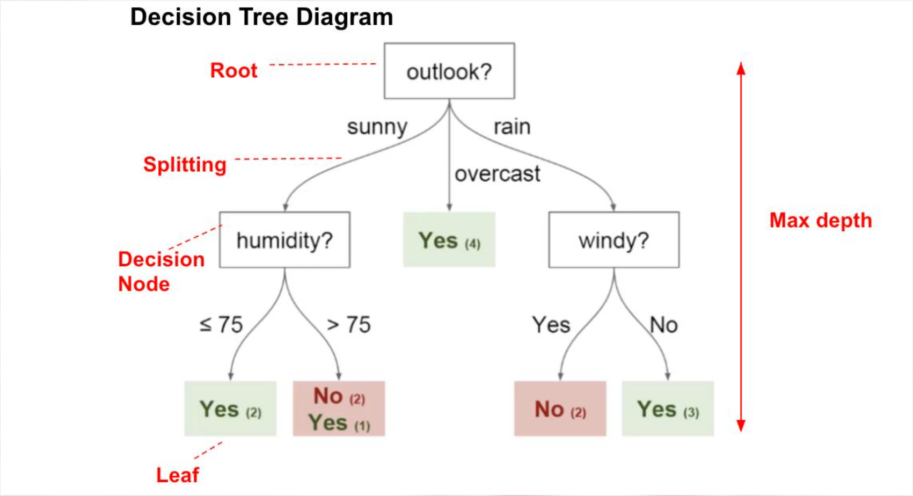

通过一系列的条件判断，一步步进行划分

特征的选择主要是靠以下的方法

**(1) 信息熵与信息增益**
信息熵：

$H(X)=-\sum_{i=1}^{k}p_i\log_2p_i $

信息增益：

$IG=H(parent)-H(children) $

信息熵描述的信息量的大小，信息量越大熵越大
也就是知道的越多，那就让熵减小的越多
所以这是IG越大越好

算法倾向于选择能够最大程度降低不确定性的划分方式

**(2) 基尼指数**

$Gini=1-\sum_{i=1}^{k}p_i^2$

Gini 越小，节点中的样本类别越纯

> 决策树容易过拟合
> 因为树不断对数据进行划分，会形成非常复杂的规则

#### 3.1.6 支持向量机

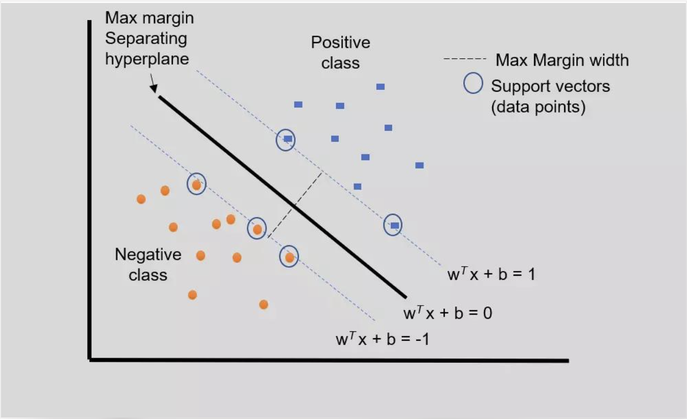

一种经典的分类算法
找到一个能够分开不同类别的最优决策边界

**核心思想**：
寻找最大间隔的分类超平面
也就是寻找支持向量，这样的话就找到边界了

> 支持向量：距离分类边界最近的样本，决定了最优分类边界的位置

数据不一定能够被一条直线很好地分割，这个时候就需要**核函数**了，能够用一条曲线进行拟合

| Kernel     | 特点                     |
| ---------- | ------------------------ |
| Linear     | 线性决策边界             |
| Polynomial | 多项式关系               |
| RBF        | 非线性边界               |
| Sigmoid    | 类似神经网络激活形式的核 |

> SVM 的核心优势是在分类的同时，能够通过最大化分类边界提高泛化能力

### 3.2 集成学习

主要有三种方式

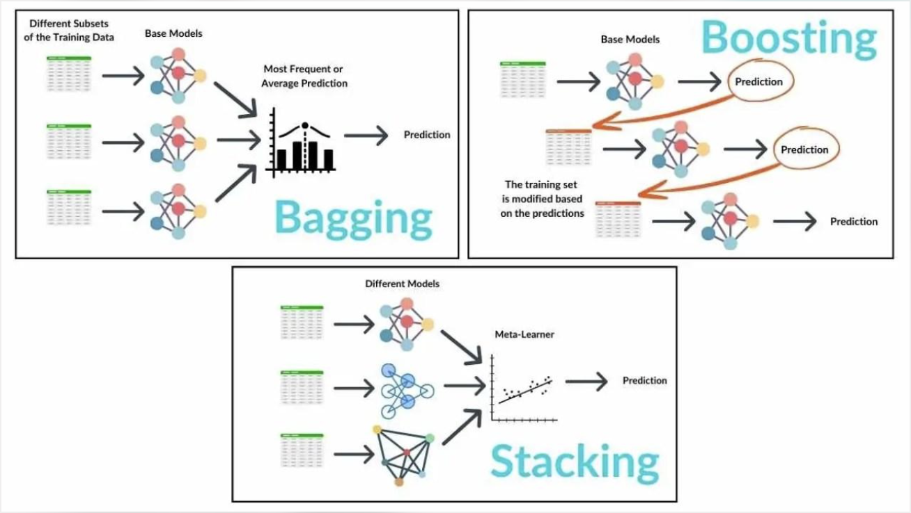

**Bagging** : 并行训练多个模型，进行投票
**Boosting** : 串行训练模型，后一个模型对前一个模型的错误进行修正
**Stacking** : 两层，第一层用多个不同的基础模型进行预测，将这些模型的输出当成新特征，第二次训练一个元模型，由元模型给出最终的结果

#### 3.2.1 随机森林

Random Forest
由多个决策树组成，每个决策树单独训练，所以可以并行训练，最终通过投票得到结果

**随机**
每个树用于训练的样本和特征都是随机的，只使用了一部分数据进行训练，从而使每棵树之间有差异

> 两种随机机制：
> 自助采样：随机抽取样本
> 随机选特征：每一次分裂时随机挑特征进行判断

+ Bagging = Bootstrap Aggregating

#### 3.2.2 Gradient Boosting

逐步建立模型，所以是并行的
后一个模型重点学习前面模型表现不好的部分

#### 3.2.3 XGBoost

Extreme Gradient Boosting
更加高效、表现更好

默认使用的模型是基于基尼指数分裂的二叉树(分类回归树)

### 3.3 无监督学习

自动发现数据的规律，无需标签

#### 3.3.1 K均值聚类

K-Means Clustering

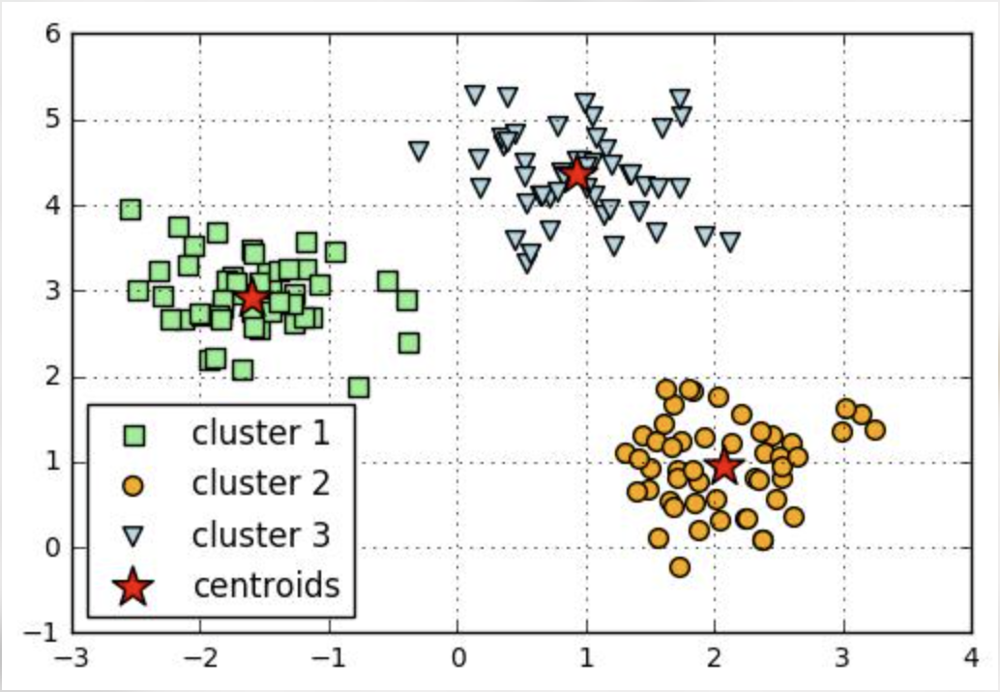

将数据划分为K个不同的簇，让同一个簇内的数据尽可能相似，不同簇之间的数据尽可能不同
这个K是超参数，认为设定

**算法流程**

1. 确定K值
2. 初始化聚类中心
3. 计算距离
4. 分配类别
5. 更新聚类中心
6. 重复

**目标**：
$$
J=
\sum_{k=1}^{K}
\sum_{x_i\in C_k}
\|x_i-\mu_k\|^2
\\
\min J
$$
尽可能降低每个数据点与其所属聚类中心的距离平方和

+ 确定一个合适的K值和初始聚类中心的位置很重要

**(1) 确定K值**

**肘部法**
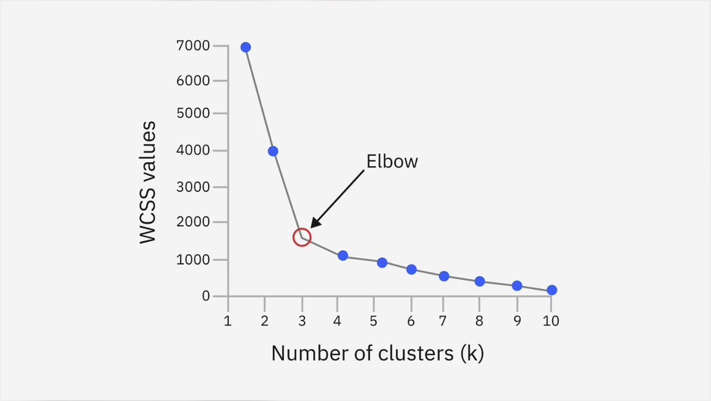

随着 K 增大，聚类误差通常会降低，但肯定不是K越大越好，我们需要一个最小的满足要求的K
所以是寻找一个误差下降趋势明显变缓的位置(肘部)

**轮廓系数**
用于评估聚类的紧密程度和分离程度。
评估会让簇内的点要越近越好，不同簇的点越远越好
取值通常在 -1 到 1 之间，越高通常表示聚类效果越好。

> K-Means也需要对数据进行标准化，因为这个评估也是基于距离的，不同尺度会导致大尺度的占据主导

#### 3.3.2 主成分分析

一种经典的线性降维方法
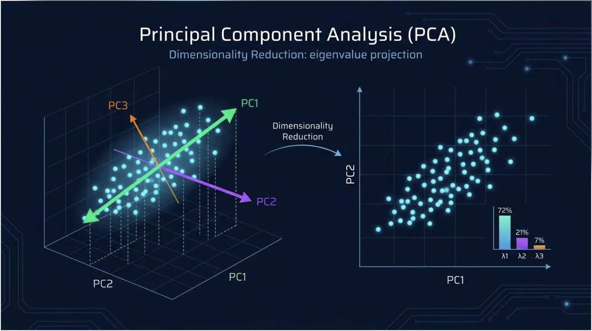

> 线性：新特征是原始特征的线性组合

一个数据有很多特征，其中很多特征是有相关性，是很相似的，使用所有数据的成本太高，这个时候就可以使用PCA进行整合降维，并尽可能保留数据中的主要变化信息

+ 主成分之间两两正交

**基本流程**

1. 对数据进行**中心化**，通常还需要根据情况标准化。
2. 计算协方差矩阵。
3. 计算特征值和特征向量。
4. 根据特征值大小排序。
5. 选择前 K 个主成分。
6. 将原始数据投影到新的低维空间。

### 3.4 对比

| 算法                | 类型   | 核心思想       | 主要用途   |
| ------------------- | ------ | -------------- | ---------- |
| Linear Regression   | 监督   | 线性拟合       | 回归       |
| Logistic Regression | 监督   | 概率分类       | 分类       |
| KNN                 | 监督   | 距离与邻居投票 | 分类、回归 |
| Naive Bayes         | 监督   | 贝叶斯概率     | 分类       |
| Decision Tree       | 监督   | 递归划分       | 分类、回归 |
| SVM                 | 监督   | 最大间隔       | 分类、回归 |
| Random Forest       | 集成   | Bagging        | 分类、回归 |
| XGBoost             | 集成   | Boosting       | 分类、回归 |
| K-Means             | 无监督 | 距离聚类       | 聚类       |
| PCA                 | 无监督 | 最大方差投影   | 降维       |

**选择**

| 数据特点或研究需求         | 可以考虑的算法      |
| -------------------------- | ------------------- |
| 关系简单、希望可解释       | Linear Regression   |
| 二分类、需要概率输出       | Logistic Regression |
| 数据量较小、局部模式明显   | KNN                 |
| 高维文本分类               | Naive Bayes         |
| 需要直观解释决策过程       | Decision Tree       |
| 中小规模、高维分类         | SVM                 |
| 表格数据、需要稳健基线     | Random Forest       |
| 表格数据、追求较高预测效果 | XGBoost             |
| 没有标签、希望自动分群     | K-Means             |
| 特征过多、需要降维         | PCA                 |

### 3.5 机器学习研究步骤

1. **确定任务类型**

   是 Regression、Classification 还是 Clustering？

2. **分析数据特征**

   样本数量多少？特征维度多高？是否存在标签？是否存在缺失值？

3. **选择 Baseline**

   先使用 Logistic Regression、Linear Regression 或简单决策树等建立基准。

4. **选择候选模型**

   根据数据特征尝试 SVM、Random Forest、XGBoost 或其他模型。

5. **设计实验**

   使用交叉验证、合适的评价指标和超参数调优。

6. **分析结果**

   比较模型表现，分析误差来源、模型局限和泛化能力。

## 4. 模型训练与评估

### 4.1 训练集、验证集、测试集

| 数据集     | 主要用途             | 是否用于训练参数 |
| ---------- | -------------------- | ---------------- |
| Training   | 学习模型参数         | 是               |
| Validation | 选择模型、调整超参数 | 否               |
| Test       | 最终评估模型         | 否               |

> 这里要注意**参数**和**超参数**
> 参数是模型自动进行调整的学习到的
> 超参数是人为设定的

**不能反复使用测试集**
假设你尝试了10种模型，每次都根据测试集的结果决定使用哪种模型。
即使模型没有直接使用测试数据进行梯度训练，你也已经通过测试结果间接地针对它进行了选择。
这会造成测试集信息泄漏，使最终测试结果过于乐观。

+ **Test Set 应当尽量只用于最终评估**

**python实现**：

```python
from sklearn.model_selection import train_test_split

# 第一次：分离测试集
X_train_val, X_test, y_train_val, y_test = train_test_split(
    X, y, test_size=0.15, random_state=42
)

# 第二次：从剩余数据中分离验证集
X_train, X_val, y_train, y_val = train_test_split(
    X_train_val, y_train_val,
    test_size=0.1765,
    random_state=42
)
```

### 4.2 过拟合、欠拟合、泛化能力

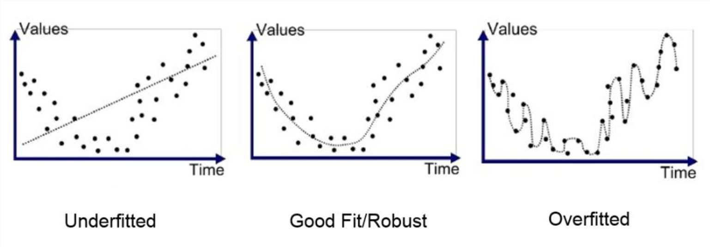

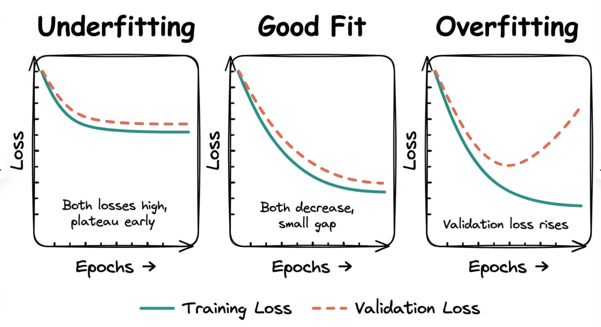

#### 4.2.1 欠拟合

没有学习到数据中的真实规律
训练集和测试集表现都不好

**解决方法**：
1.使用更加复杂的模型
2.减少正则化
3.增加有用的特征
4.加强训练

#### 4.2.2 过拟合

过度学习，把噪声也学习到了
训练集表现好，测试集表现差，泛化能力差

**解决方法**
1.降低模型复杂度
2.使用正则化
3.增加训练数据
4.早停

#### 4.2.3 泛化能力

指模型在没有见过的新数据上做出正确预测的能力

#### 4.2.4 偏差方差均衡

$$
\mathbf{E}\big[(y-\hat{f}(x))^2\big]
=\text{Bias}^2(\hat{f}(x))
+\text{Var}(\hat{f}(x))
+\sigma^2
$$
其中：

- $\mathbf{E}\big[(y-\hat{f}(x))^2\big]$：期望测试误差（MSE，均方误差）
- $\text{Bias}^2$：偏差平方，模型本身拟合能力不足带来的误差（欠拟合）
- $\text{Var}$：方差，模型在不同训练集上波动大（过拟合）
- $\sigma^2$：固有噪声，数据本身的随机噪声，任何模型都消不掉

> 注意误差和噪声，误差可以减小，但是噪声本来就存在不可去除
> 比如传感器采集，温度、图像、传感器读数自带仪器误差

对这个公式简单理解就是
结果 = 偏差 + 方差 + 噪声(这个一般直接不考虑)
主要就是记住下面这个图就可以


随着程度的加深，训练越来越多轮或者模型越来越复杂等等
偏差会降低，方差会加大
从而模型总的损失是先大后小再大
模型训练就是为了找到这个最低点

### 4.3 模型评价指标

不同任务有不同的评价指标
主要是两类：**分类问题**，**回归问题**

#### 4.3.1 分类问题评价

**(1) 混淆矩阵**
模型输出两类结果：Positive 和 Negative

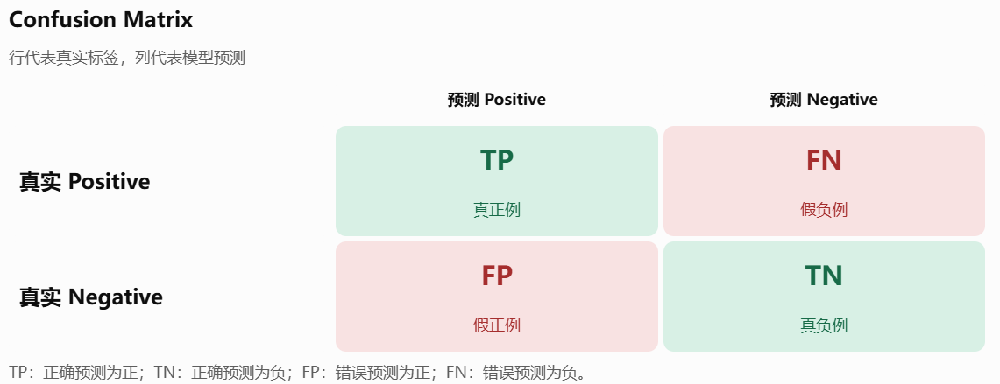

通过这个有**四个重要指标**：

**Acc 准确率**
$$
Accuracy=\frac{TP+TN}{TP+TN+FP+FN}
$$

> 就是对于所有情况中预测正确的(正确预测为P和正确预测为N)

**P 精确率**
precision
$$
P=\frac{TP}{TP+FP}
$$

> 对于正样本来说预测准确的

**R 召回率**
Recall
$$
R=\frac{TP}{TP+FN}
$$

> 对所有的正样找出多少(FN就是错误预测为负样本，那实际上就是正样本，TP+FN就是真实的所有正样本)

**F1**
均衡精确率和召回率
$$
F1=2\cdot\frac{P\cdot R}{P+R}
$$
**多类别**
将其他预测错的都记为负
求 P、R、F1 用的是平均值
有三种求平均的方法
1.宏平均：算每一个的P、R、F1然后加起来平均
2.加权平均：宏平均是算术平均，这里变为加权平均
3.微平均：把每一个的TP、FP、FN全部加起来，然后进行计算

**(2)ROC Curve 与 AUC**

**ROC Curce**
Receiver Operating Characteristic Curve
受试者工作特征曲线

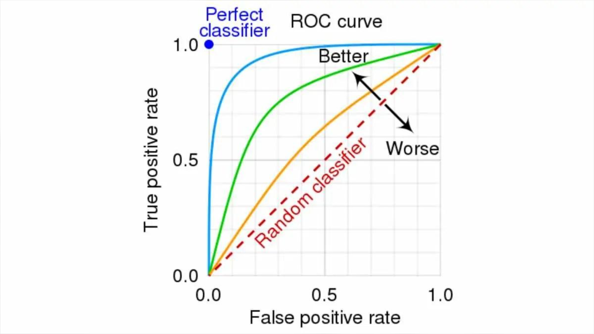

- 横轴(FPR)：False Positive Rate 假阳性率。
- 纵轴(TPR)：True Positive Rate（也就是 Recall，或者说是真阳性率）。
- AUC(Area Under Curve)：ROC 曲线下的面积。

$$
FPR=\frac{FP}{FP+TN}
$$

> 就是真实负样本中预测为正样本的概率

$$
TPR=\frac{TP}{TP+FN}
$$

>一般来说：
>
>- AUC = 1：完美区分。
>- AUC = 0.5：与随机排序接近。
>- AUC 越高，模型区分正负样本的能力通常越强。
>
>直观的理解就是假阳性率越小越好，真阳性率越大越好，那么曲线就会靠近左上角，AUC就是1

**注意：AUC 反映的是模型对正负样本的排序区分能力，并不意味着概率一定校准得好**

> 我的理解是概率的排序是准确的，但是概率预测的值并不准确

**(3) Acc有时不可靠**

当模型准确率非常高的时候，模型不一定是正确的

> 假设你有1000条疾病筛查数据：
>
> - 990人没有疾病。
> - 10人患有疾病。
>
> 如果模型无论如何都预测 Negative：
>
> $Acc=\frac{990}{1000}=99\%​$
>
> 准确率高达99%，但模型一个患者都可能识别不出来

所以对于正负样本的分布非常不平衡的话，Acc就不可靠

#### 4.3.2 回归问题评价

**(1) MAE**
Mean Absolute Error
平均绝对误差
$$
MAE=\frac1n\sum_{i=1}^{n}|y_i-\hat y_i|
$$

> 直观，受极端误差影响相对较小

**(2) MSE**
Mean Squared Error
均方误差
$$
MSE=\frac1n\sum_{i=1}^{n}(y_i-\hat y_i)^2
$$

> 对较大的预测误差惩罚更重

**(3) RMSE**
Root Mean Squared Error
均方根误差
$$
RMSE=\sqrt{MSE}
$$

> 与目标变量具有相同单位，有直观意义

**(4) $R^2$**
Coefficient of Determination
决定系数
$$
R^2=1-
\frac{\sum_i(y_i-\hat y_i)^2}
{\sum_i(y_i-\bar y)^2}
$$

> - R² = 1：完美拟合。
> - R² = 0：与均值基准的平方误差表现相同。
> - R² 小于0：模型可能比均值基准更差。
>
> 表示模型和标准的差距，表示模型相对于使用目标变量均值作为预测值的基准，解释了多少样本内的变异

### 4.4 交叉验证

数据过少

> 假设你只有100条数据。
> 如果只进行一次训练集/测试集划分，结果可能受到随机划分影响。
> 另一种划分可能得到完全不同的准确率。
> Cross-Validation 可以帮助我们更稳定地评价模型。

**K折交叉验证**

假设使用5-Fold Cross-Validation：
将数据分成5份，每次用其中4份训练，剩余1份验证。

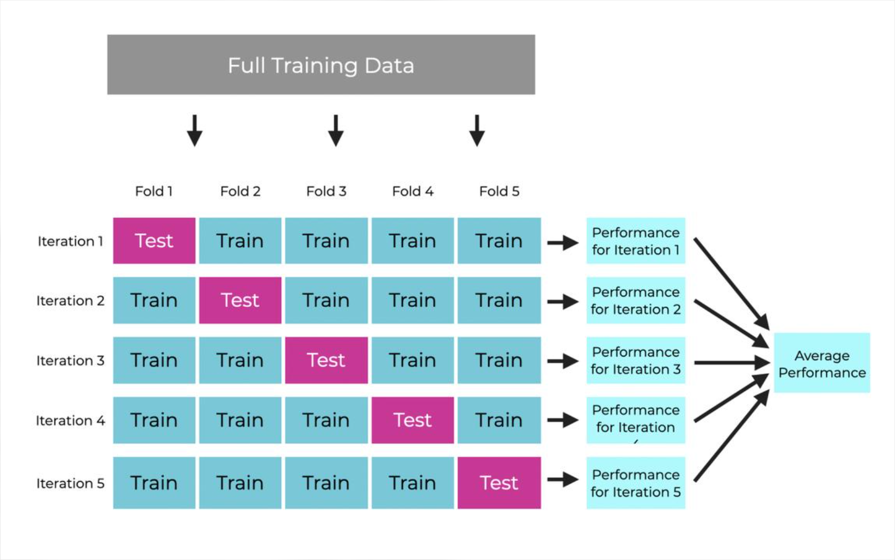

> 整个过程：
>
> 1. 第一次：第1份作为验证集，其余4份训练。
> 2. 第二次：第2份作为验证集，其余4份训练。
> 3. 第三次：第3份作为验证集。
> 4. 第四次：第4份作为验证集。
> 5. 第五次：第5份作为验证集。

+ 注意时间序列不能随意打乱进行K折，会有信息泄露

### 4.5 数据泄露

在**模型训练**或**模型选择**的过程中，使用了不该获取的信息，导致评价结果过于乐观

任何的学习行为和对信息的使用只能用训练集，测试集只是用于最终的预测

| 场景                                 | 问题                 |
| ------------------------------------ | -------------------- |
| 使用未来数据预测过去                 | 时间泄漏             |
| 先对全体数据做特征选择               | 测试集参与特征选择   |
| 先对全体数据做缺失值填充             | 测试集信息参与预处理 |
| 同一个人的记录同时出现在训练和测试集 | 个体信息泄漏         |
| 使用预测目标产生之后才知道的特征     | 目标泄漏             |

### 4.6 超参数调优

模型性能往往会受到超参数的影响，直接随机设定往往效果不好，这个时候就需要一些技巧了

**(1) 网格搜索**
提前指定多个候选参数，然后尝试所有组合

**(2) 随机搜索**
在前面网格搜索的基础上不是尝试所有的组合，而是随机抽取一定数量的组合

**(3) 贝叶斯优化**
根据之前的实验结果，决定下一次要尝试使用什么参数

### 4.7 数据调整

#### 4.7.1 正则化

**(1) L1正则化**
Lasso
$$
L=L_{original}+\lambda\sum_j|w_j|
$$

> $w_j$ 是参数，$\lambda$ 是超参数

+ 使用绝对值进行惩罚
+ 可以使一些参数直接变为0
+ 有选择特征的作用

**(2) L2正则化**
岭回归
$$
L=L_{original}+\lambda\sum_jw_j^2
$$

+ 使用平方进行惩罚
+ 可能让一些参数趋近于0但是一般不会变为0

| 特征      | L1           | L2           |
| --------- | ------------ | ------------ |
| 惩罚方式  | 绝对值       | 平方         |
| 权重变为0 | 可能         | 通常不会     |
| 稀疏性    | 强           | 较弱         |
| 主要用途  | 特征选择倾向 | 控制权重大小 |

#### 4.7.2 早停

一般用于深度学习

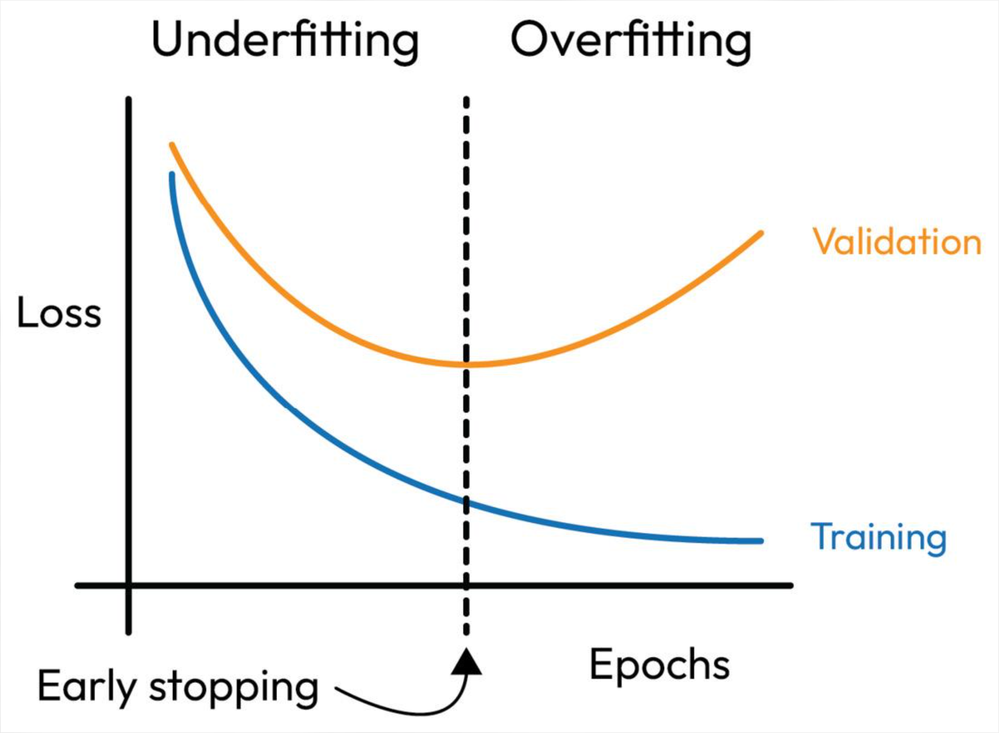

> 训练过程中：
>
> - Training Loss 继续下降。
> - Validation Loss 先下降，之后开始上升。
>
> 当验证集表现不再改善时，可以停止训练，并恢复到验证表现最好的模型参数。

#### 4.7.3 类别不平衡的处理

> 假设一个欺诈检测数据集：
>
> - 正常交易：99,000条。
> - 欺诈交易：1,000条。
>
> 正负样本比例是99:1。
>
> 模型可能倾向于预测正常交易。

**(1) 权重设置**
给少数样本设置更大的损失权重
从而让模型更加重视少数类别的错误

**(2) 过采样**
通过一定的方法增加少数样本的数量

+ 复制：复制少数类样本
+ 生成：通过少数类样本的临近关系合成新的样本

**(3) 欠采样**
减少多数类别样本的数量，从完整数据中抽取一部分

### 4.8 完整实验

#### 4.8.1 实验举例

> 假设研究任务是：
>
> **预测学生是否能够通过考试。**
>
> 一个标准流程如下：
>
> 1. **Data Collection**
>
>    收集学生学习时间、出勤率、作业成绩等数据。
>
> 2. **Exploratory Data Analysis（EDA）**
>
>    检查数据分布、缺失值、异常值和特征之间的关系。
>
> 3. **Data Preprocessing**
>
>    处理缺失值、编码类别变量、标准化特征。
>
> 4. **Train / Test Split**
>
>    划分训练集和测试集，必要时从训练集内部划分验证集。
>
> 5. **Model Selection**
>
>    选择 Logistic Regression、Decision Tree、Random Forest 等模型。
>
> 6. **Cross-Validation & Tuning**
>
>    使用交叉验证和超参数搜索进行模型选择。
>
> 7. **Final Evaluation**
>
>    使用没有参与模型选择的测试集，计算 Precision、Recall、F1、AUC 等指标。
>
> 8. **Error Analysis**
>
>    分析错误预测样本，理解模型在哪些情况下表现不好。
>
> 9. **Interpretation & Reporting**
>
>    解释结果、比较 Baseline、讨论局限性并报告实验。

#### 4.8.2 错误分析

**可能的一些问题**:

- 哪些样本预测错误？
- 是否某一类样本特别容易预测错误？
- 是否某些特征存在异常？
- 是否训练数据不够？
- 是否模型假设不适合当前数据？
- 错误是否集中在特定人群、时间或场景？


## 5. 深度学习

### 5.1 基本概念

**(1) 介绍**

机器学习的一个分支，通过神经网络从数据中自动学习特征
和传统机器学习最大的不同就是机器学习需要人工设计特征，而深度学习能够通过多次网络自动完成特征的学习

**(2) 核心思想**

深度学习的核心就是神经网络
而神经网络由大量相互连接的计算单元组成

每个神经元通常执行三个步骤：

1. 接收输入
2. 进行加权求和
3. 通过激活函数产生输出

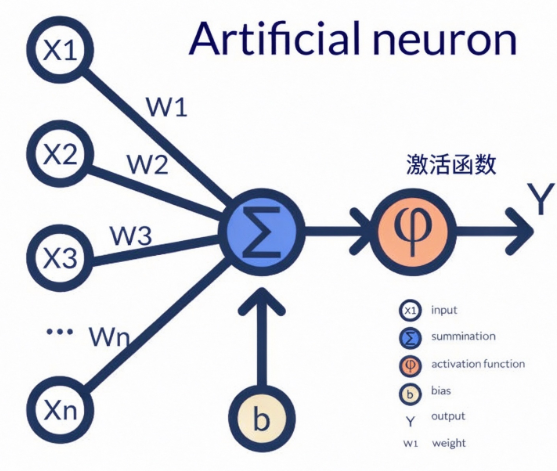

一个神经元可以表示为：
$$
z=\sum_{i=1}^{n}w_i x_i+b \\
y=f(z)
$$
其中：

- $x_i$：输入特征
- $w_i$：权重（Weight）
- b：偏置（Bias）
- z：线性组合
- f：激活函数（Activation Function）
- a：神经元输出

可见也是学习各种参数形成一个能够近似复杂函数的模型

### 5.2 神经网络的结构

#### 5.2.1 三种基本层

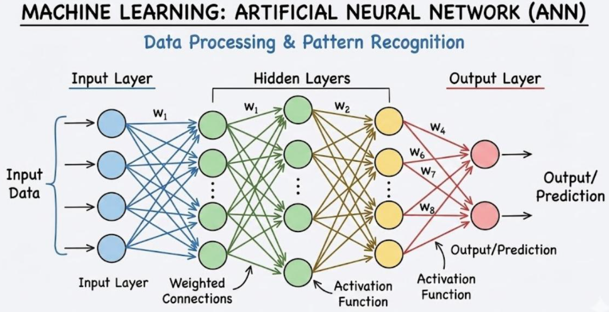

以典型的前馈神经网络为例
组成有以下几个部分

| 层     | 英文         | 功能                     |
| ------ | ------------ | ------------------------ |
| 输入层 | Input Layer  | 接收输入数据             |
| 隐藏层 | Hidden Layer | 提取特征、进行非线性变换 |
| 输出层 | Output Layer | 产生预测结果             |

> 例如，预测房价：
> 输入层接收：
>
> - 房屋面积
> - 房间数量
> - 房屋年龄
>
> 隐藏层学习这些特征之间的复杂关系。
> 输出层预测房屋价格。

#### 5.2.2 激活函数的作用

假设只有一个线性层：
$$
y=Wx+b
$$
即使增加多个线性层，只要中间没有非线性激活函数，整个网络仍然可以合并成一个线性变换。

> 例如：
> $$
> h=W_1x+b_1 \\
> y=W_2h+b_2
> $$
> 代入后：
> $$
> y=W_2(W_1x+b_1)+b_2 \\
> y=W_2W_1x+W_2b_1+b_2
> $$
> 它仍然是线性函数。

因此，神经网络需要**引入非线性激活函数**，才能学习复杂的非线性关系。
并且层数越深，能够拟合的函数越复杂

#### 5.2.3 各种激活函数

**(1) Sigmoid**
$$
\sigma(x)=\frac{1}{1+e^{-x}}
$$
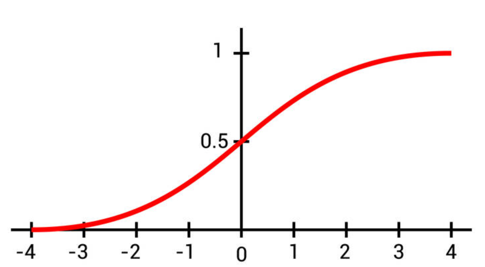

+ 输出范围是0到1
+ 常用于二分类的输出层

**(2) Tanh**
$$
\tanh(x)=\frac{e^x-e^{-x}}{e^x+e^{-x}}
$$
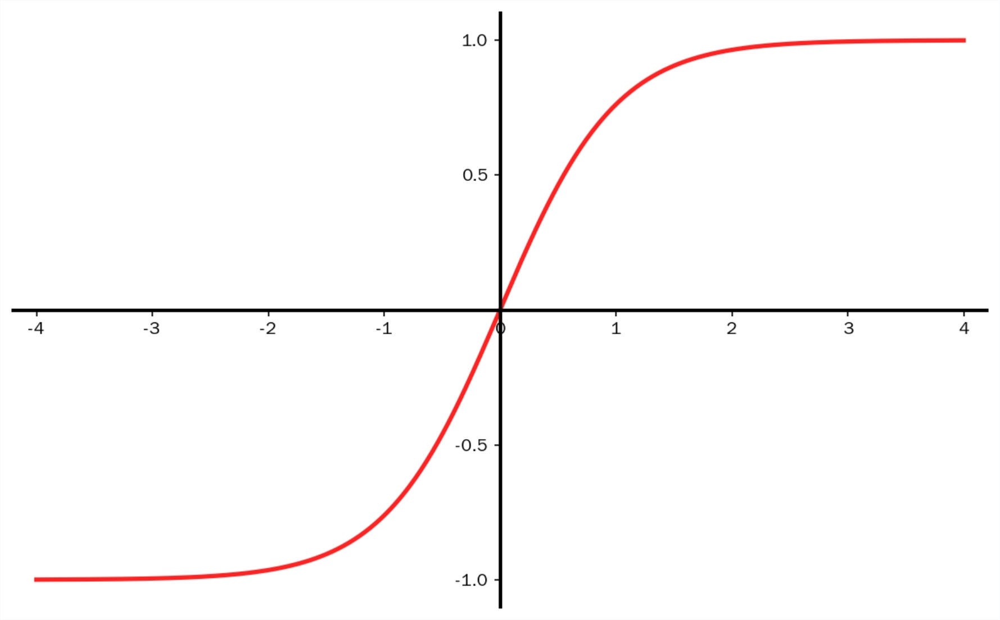

+ 输出范围是 -1 到 1 

**(3) ReLU**
$$
ReLU(x)=\max(0,x)
$$


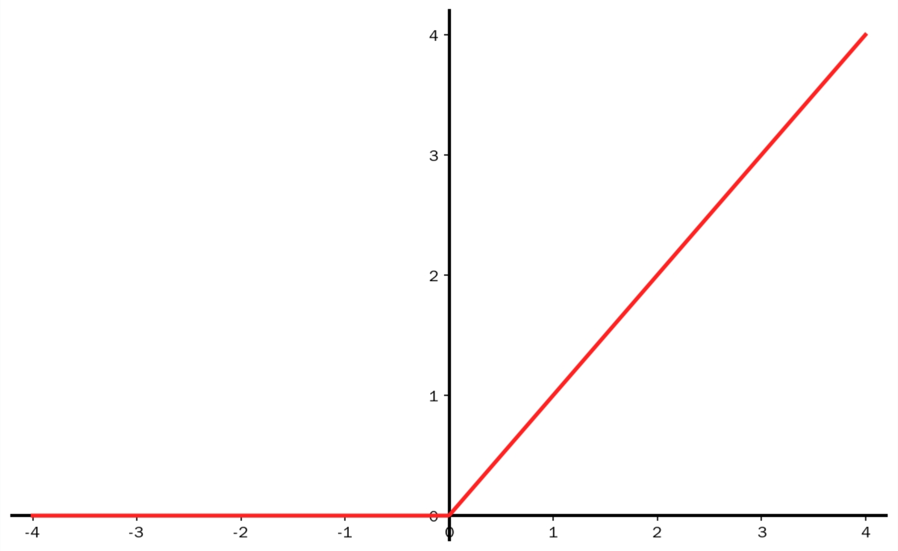

+ 正数区域梯度为1
+ 计算简单
+ 常用于隐藏层
+ 但是负数区域输出为0，可能导致神经元不更新

**(4) Softmax**
$$
P(y=i)=\frac{e^{z_i}}{\sum_{j=1}^{K}e^{z_j}}
$$
常用于多分类任务的输出层
将多个输出转换成总和为1的概率分布

注意这里的值和AUC有点一样，都不是真实的发生概率，只是一个相对的关系

输出可以作为概率解释，但是不保证模型预测一定经过校准

#### 5.2.4 参数量的计算

假设一个全连接层有：

- 输入维度：n
- 输出维度：m

权重矩阵大小为：
$$
W\in\mathbb{R}^{m\times n}
$$
参数数量：
$$
mn+m
$$
其中 \(mn\) 是权重数量，\(m\) 是偏置数量。

> 公式是 : $\boldsymbol{z} = W\boldsymbol{x} + \boldsymbol{b}$
> $$
> W= \begin{bmatrix} w_{11} & w_{12} & \dots & w_{1n}\\ w_{21} & w_{22} & \dots & w_{2n}\\ \vdots & \vdots & \ddots & \vdots\\ w_{m1} & w_{m2} & \dots & w_{mn} \end{bmatrix} , \mathbf{x}=\begin{bmatrix} x_1\\ x_2\\ \vdots\\ x_n \end{bmatrix} , \boldsymbol{b}= \begin{bmatrix} b_1\\ b_2\\ \vdots\\ b_m \end{bmatrix}
> $$
> $\mathbf{W}$ 是m行n列的

### 5.3 前向传播与损失函数

#### 5.3.1 前向传播

就是预测流程，从前到后

> 一开始参数还没有更新，是随机设定或按照一定技巧进行设定的

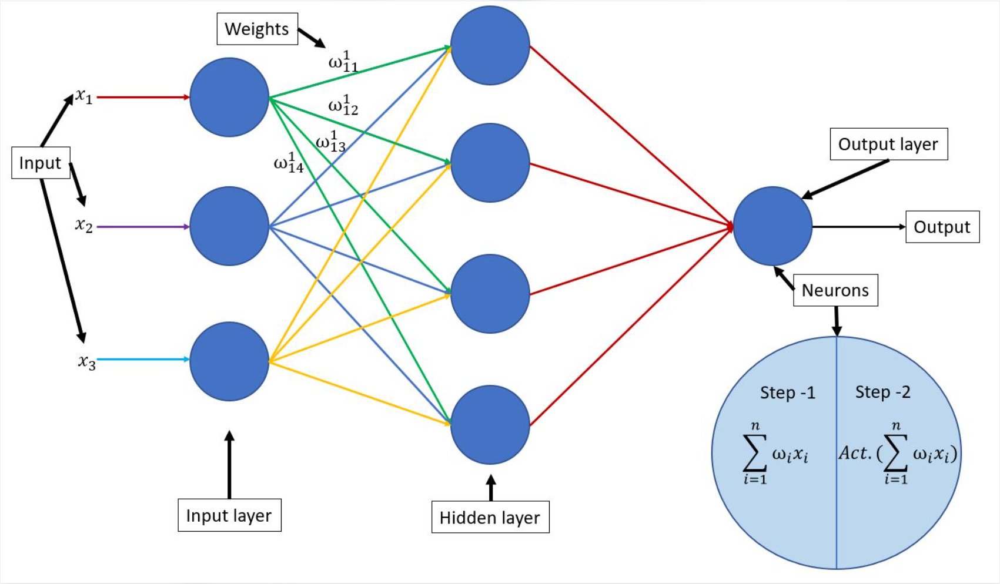

**前向传播的过程**：

输入数据 -> 线性变换 -> 激活函数 -> 下一层 -> 预测

#### 5.3.2 损失函数

做出预测后对损失进行计算

### 5.4 反向传播与梯度下降

#### 5.4.1 反向传播

就是使用链式法则对每个参数求偏导，确定这个参数向哪个方向变化能够使损失下降最快

#### 5.4.2 梯度下降

在计算知道了梯度的基础上自动对参数进行更新从而降低损失

#### 5.4.3 优化器

参数更新的不同方式
SGD、Momentum、Adam、AdamW

#### 5.4.4 学习率

决定每次参数更新的步长

#### 5.4.5 梯度消失

梯度太小了

**解决办法**：

+ 使用ReLU等激活函数
+ 使用更加合适的参数
+ 使用残差连接
+ 批归一化或层归一化
+ 使用更合适的网络结构

#### 5.4.6 梯度爆炸

梯度太大了
让参数更新不稳定

**解决方法**：

+ 梯度裁剪，梯度的范数超过阈值时按比例缩小
+ 使用更加合适的参数
+ 调整学习率
+ 采用更合适的网络结构

### 5.5 经典深度学习架构

#### 5.5.1 CNN

卷积神经网络

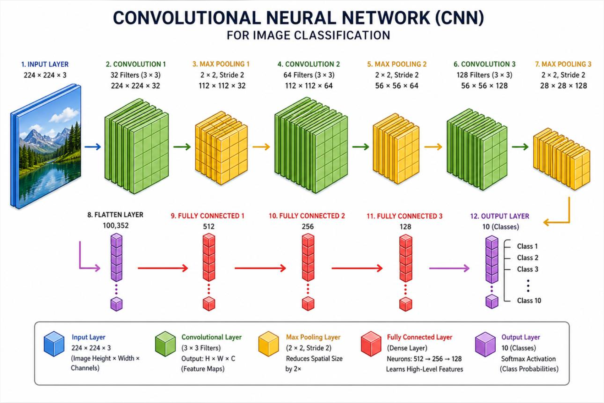

主要用于图像、视频、具有空间结构的数据


