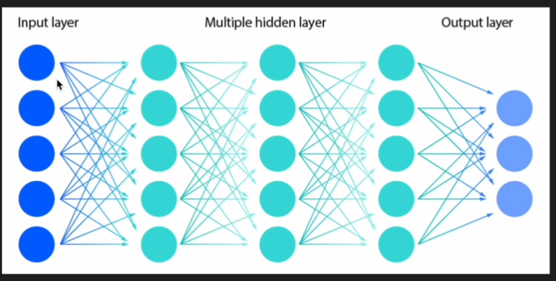

+++
author = "morningCPU"
title = "深度学习-MLP到神经网络"
description = "多层感知机与神经网络"
date = 2026-11-27T16:05:17+08:00

readingtime = false

categories = ["深度学习"]
tags = ["深度学习"]

slug = "006"

series = []
aliases = []

draft = false
+++

# 深度学习-MLP到神经网络

## 1. 多层感知机的一般结构

多层感知机 (MLP)

多个感知机之间按层排列，层间进行全连接

输入层接收原始特征，隐藏层进行中间的特征提取与运算，输出层给出最终的结果

## 2. 激活函数

多层线性变换的叠加依旧是一个线性变换

要增加激活函数，增加非线性

