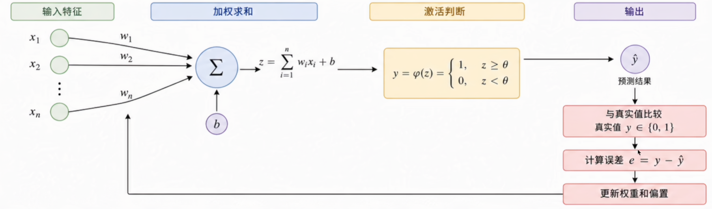

+++
author = "morningCPU"
title = "深度学习-感知机"
description = "介绍感知机模型"
date = 2026-11-27T15:12:48+08:00

readingtime = false

categories = ["深度学习"]
tags = ["深度学习"]

slug = "005"

series = []
aliases = []

draft = true
+++

# 深度学习-感知机

## 1. 作用

给定一组输入数据，自动找到一条决策边界，将不同类别的数据正确区分

> 包含了神经网络的所有核心要素 ： 输入、权重、求和、激活、误差反馈、参数更新

## 2. 基本结构

对输入做加权求和，与阈值比较做出判断，根据错误反馈进行调整

> 错误修正公式：
> $w_i \leftarrow w_i + \eta \cdot (y - \hat{y}) \cdot x_i$

## 3. 重大问题

XOR(异或)问题无法解决
这是因为异或线性不可分

