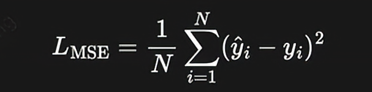
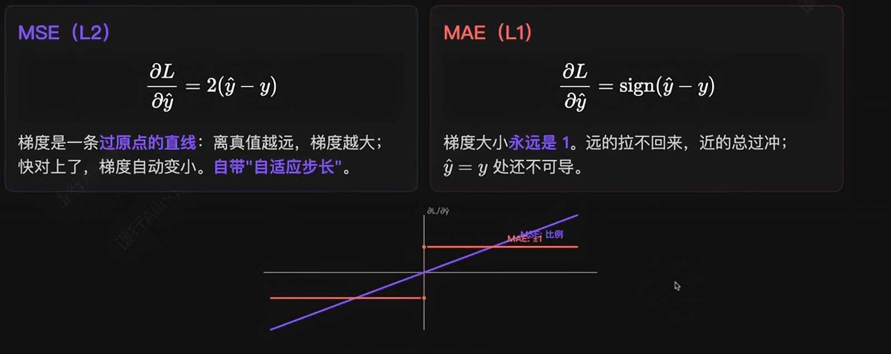
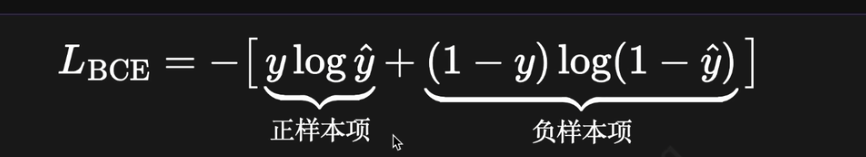

+++
author = "morningCPU"
title = "深度学习-损失函数"
description = "介绍损失函数"
date = 2026-11-27T20:35:55+08:00

readingtime = false

categories = ["深度学习"]
tags = ["深度学习"]

slug = "010"

series = []
aliases = []

draft = false
+++

# 深度学习-损失函数

## 1. 回归任务

### 1.1 MSE

均方误差，回归任务的默认损失

有时候平方前面加个1/2让求导结果更好看

**MSE假设误差分布符合正态分布**
假设大部分的样本误差接近0

在这条假设下，最小化MSE就等价于最大似然估计

**缺点**：
平方让MSE对离群点过分敏感

**用于分类问题不合适**：

1. MSE会让差2比差1严重4倍，而在分类问题中，不同标签之间的区别是严重程度一样的
2. 配置Sigmoid使用会让梯度消失

## 2. 分类任务

### 2.1 要求

1. 单调递减于输入
   因为对于分类任务，输入会是对这个预测正确性的打分p，p在0到1之间
   p越大损失越掉
2. 越错惩罚要越大
3. 多样本可加

> $-logp$ 就符合这些要求

### 2.2 交叉熵

$$
H(p,q) = -\sum_x p(x)\log q(x)
$$

越小越合拍

p(x)是真实情况，q(x)是预测情况

**自信息** : -logp(x)
表达的是一件事情发生会带来的信息量的大小
一件事情发生的概率越小,带来的信息就越多。反之一件事情大概率发生，那说明现在已经有很多关于这件事情的信息了，带来的新信息就会比较少,-log正好能够很好得表示

所以交叉熵可以像下面一样进行直观的理解：

p(x)是真实发生的概率，这个是固定的
而在预测模型中，可以通过自信息调整这个概率的分量
一件真实发生概率很大的事件，预测发生概率很小，那么计算得到的值就会很大
但是也有一个问题：**交叉熵天然会更看重真实分布里高频的样本，低频样本就算预测翻车，它带来的惩罚也很轻**，在类别不平衡任务里，需要额外改造

### 2.3 二分类交叉熵

BCE

其实就是交叉熵公式，用了点技巧把求和展开了

并且BCE加上sigmoid会让求导非常结果非常简单，并且去掉了 $\hat{y}(1-\hat{y})$

### 2.4 多分类交叉熵

softmax+CE

