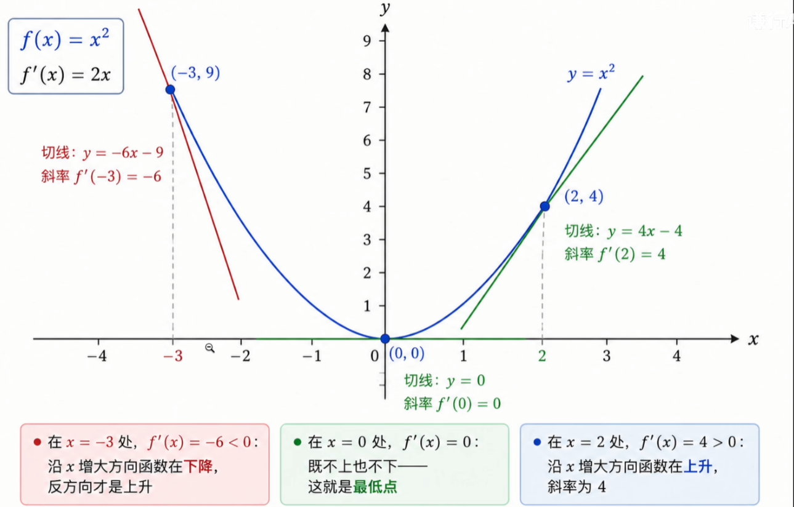
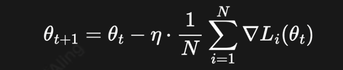
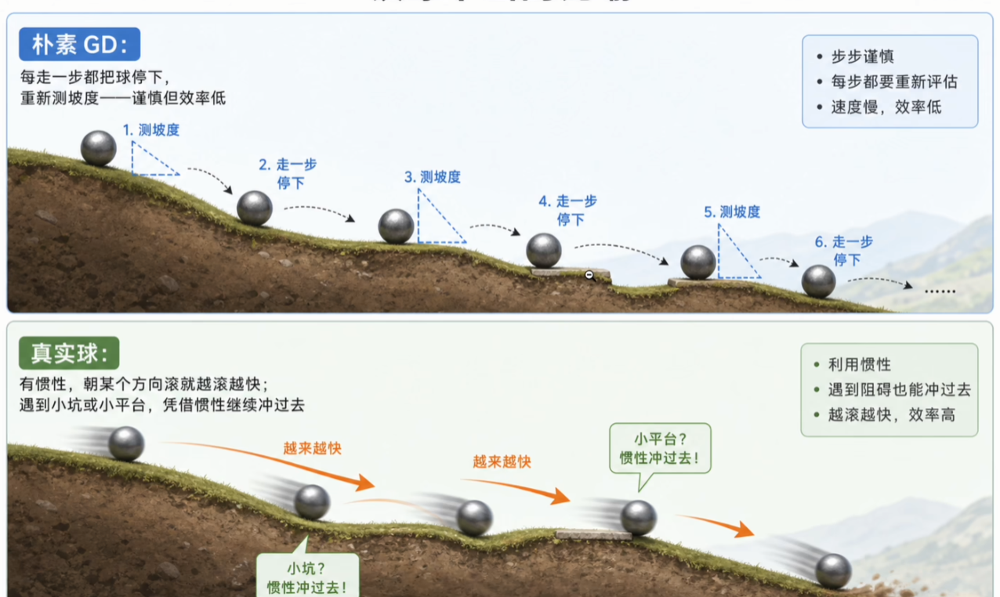
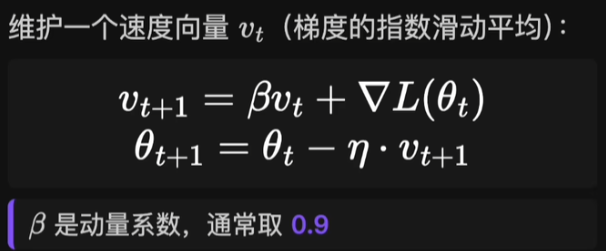
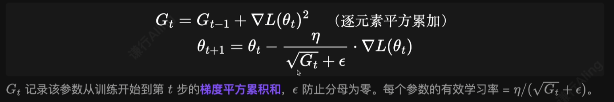
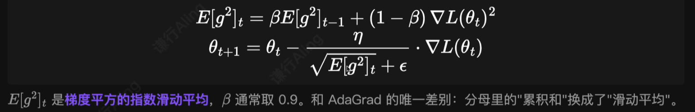

+++
author = "morningCPU"
title = "深度学习-梯度下降"
description = "梯度下降学习，各种优化器"
date = 2026-11-27T19:24:20+08:00

readingtime = false

categories = ["深度学习"]
tags = ["深度学习"]

slug = "009"

series = []
aliases = []

draft = true
+++

# 深度学习-梯度下降

## 1. 导数

上升最快的方向
所以梯度下降的话要加上负号

> 使用梯度自带刹车：越靠近最低点梯度越小
>
> 永远最近：只是无限逼近

## 2. 优化器

### 2.1 BGD

每次用全部样本

在进行更新时，会先完整遍历整个训练集，计算所有样本损失的平均梯度，再进行更新

**优点**：
方向准确，全局使用，几乎没有噪声
**缺点**：
训练成本高
缺少随机性，这样在鞍点或梯度小的地方可能跳不出来

### 2.2 SGD

随机梯度下降，每次更新随机抽取一个样本用于更新

**优点**：
计算成本低，可以跳出局部最优
**缺点**：
震荡剧烈，对离群样本敏感

### 2.3 Mini-batch SGD

使用一部分样本

### 2.4 Momentum

加上动量，会累积前面的梯度

**三大作用**：

1. 加速方向一致
2. 抑制震荡方向
3. 可以穿过局部最优点

**缺点**：
可能冲过头，在最优点附近小幅度震荡

### 2.5 AdaGrad

让每个参数有自己的学习率

对于累加多的，把学习率变小，防止过度更新
对于累加少的，把学习率变大，保证充分学习

**缺点**：
G一直累加，这会让学习率一直变小，梯度消失

### 2.6 RMSProp

RMS : 均方根

使用最近的一些(我的理解是影响力，$\beta$ 就是来调节这个的)，而不是一直加

### 2.7 Adam

把自适应学习率和动量相结合

### 2.8 AdamW

对Adam的修正
主要是Adam对正则化的处理是放在梯度处理里面的，但是这样的话自适应会让这个参数的调整不合理
梯度大的参数衰减不足，梯度小的过渡衰减
AdamW就把梯度更新和权重衰减相分离

### 2.9 Muon

将奇异值拉平
解决少数方向太强、垄断训练、学习率上不去的问题

## 3. 实践选择

**CV任务**：
SGD + Momentum

**NLP/大模型**
AdamW , Muon

**快速试验**
Adam

**稀疏/在线/短周期**
比如广告CTR，传统NLP
AdaGrad

