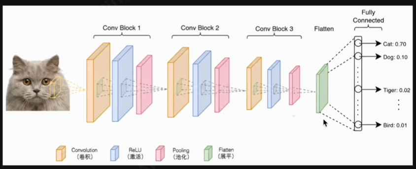

+++
author = "morningCPU"
title = "深度学习-概述"
description = "DeepLearning 一些简单的引入知识"
date = 2026-11-27T14:52:48+08:00

readingtime = false

categories = ["深度学习"]
tags = ["深度学习"]

slug = "004"

series = []
aliases = []

draft = true
+++

# 深度学习-概述

> 学习来源 ： https://www.bilibili.com/video/BV1NMVn6vE7o/

## 1. 本质

AI > ML > DL
深度学习就是用多层神经网络提取特征学习数据这种数据学习方式进行学习的方法

## 2. 应用

+ 计算机时间 CV
+ 自然语言处理 NLP
+ 智能语音
+ 推荐系统

## 3. 与机器学习的不同

机器学习需要人工提取特征，这个过程本身是不容易的，深度学习可以通过多层神经网络自动完成这个特征提取的过程

也就是说机器学习处理的基本上是结构化数据，对于非结构化数据需要人工进行特征工程提取特征从而整理得到结构化数据，而深度学习就可以直接对非结构化数据进行学习

## 4. 实现原理

逐层抽象

主要就是三个层级：输入层，隐藏层，输出层
逐层抽象提取特征，最后进行预测

