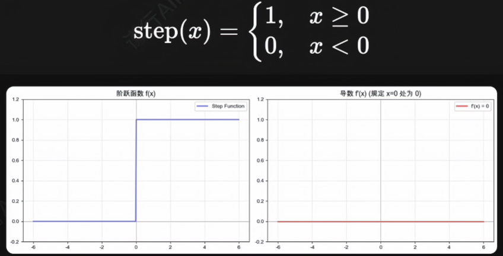
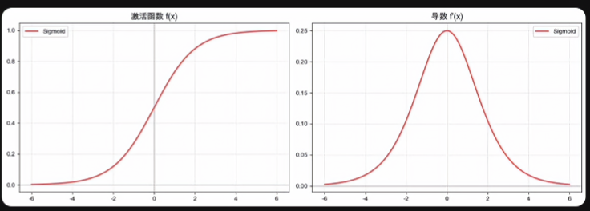
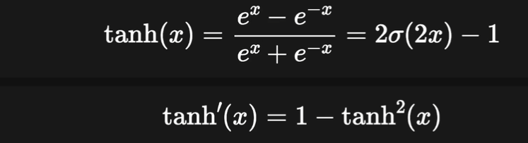
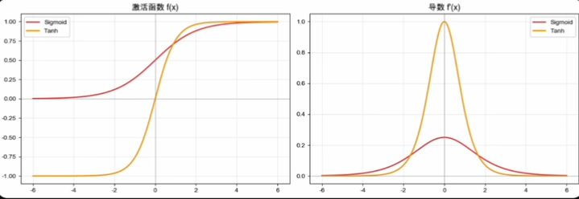
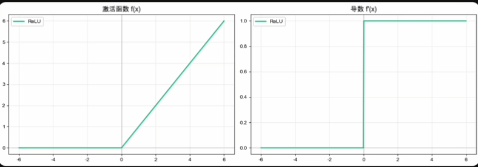
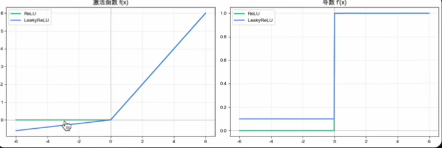
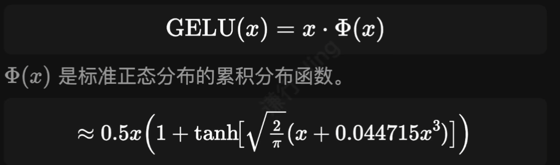
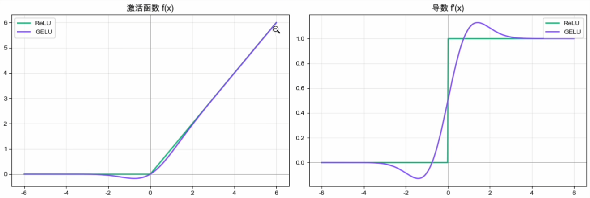
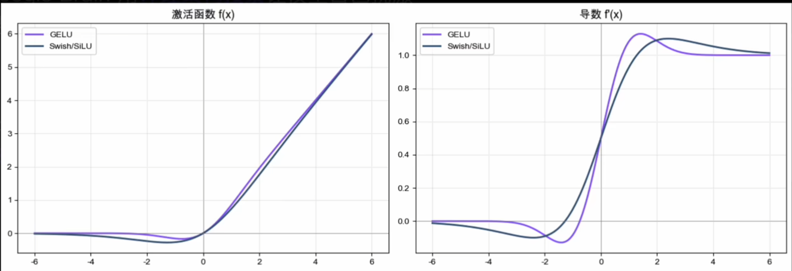

+++
author = "morningCPU"
title = "深度学习-激活函数"
description = "各种激活函数"
date = 2026-11-27T16:51:42+08:00

readingtime = false

categories = ["深度学习"]
tags = ["深度学习"]

slug = "008"

series = []
aliases = []

draft = true
+++

# 深度学习-激活函数

## 1. 非线性函数

为什么要同时使用线性函数和非线性函数呢，直接全部使用非线性函数不就好了

理论上是可以的，但是工程实现困难，想要一个好的用于非线性叠加的函数也很难
而这种线性函数+激活函数的叠加方式简单好用，并且证明了可以拟合任意复杂函数

## 2. 好的激活函数

1. 非线性
2. 几乎处处可导(对于不可导点可以设定特定的值)
3. 梯度值良好，不容易导致梯度消失或爆炸，最好就是接近1
4. 输出零中心
5. 计算便宜
6. 单调、平滑、有界

## 3. 激活函数

### 3.1 阶跃函数

就是用于感知机的
这里可以看到导数为0，不可用于梯度下降，所以多层无法训练

### 3.2 Sigmoid

将区间控制在0到1

**缺点：**

1. 导数最大值过小，多层容易导致梯度消失，里面的参数不更新
2. 所有的输出值都是正数，参数更新的灵活性下降
   每一个神经元上这参数的更新方向的符号都会相同(隐藏层的第一层不一定，因为前面输入层没有激活)，灵活性更弱

### 3.3 Tanh

+ 零对称
+ 导数的最大值更大了

但是可以看到，对于导数，在输入偏大或输入偏小的时候导数都几乎为0，会导致梯度消失

### 3.4 ReLU

### 3.5 Leaky ReLU

解决Deal ReLU的问题

### 3.6 GELU

### 3.7 Swish/SiLU

